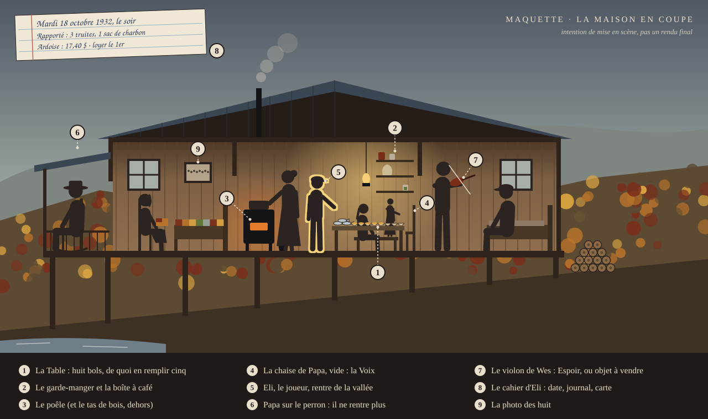

# As Long as We're Here · *Tant qu'on est là*

> « Huit bols sur la table. De quoi en remplir cinq. Tu as quatorze ans. »

Est du Kentucky, 1932. L'usine a fermé. Henry Caudill, 14 ans, parcourt la vallée pour rapporter de quoi nourrir sa famille de huit personnes. Le soir, on partage la marmite.

**Aventure narrative en épisodes, en 2D de profil**, avec gestion familiale et mini-jeux d'adresse. Inspirée des *Raisins de la colère* et de *Qu'elle était verte ma vallée*.



## Jouer à l'épisode 1 : « Le dernier sifflet »

Environ 30 minutes. Souris, clavier ou écran tactile (à l'horizontale).

- **Le plus simple** : ouvrir `game/dist/tant-quon-est-la.html` dans un navigateur (un seul fichier, aucune installation).
- **Version de développement** : ouvrir `game/index.html`.

Le jeu sauvegarde automatiquement à chaque étape ; « Reprendre » sur l'écran titre. Échap ouvre le menu.

## Documents

- [**Document de conception (GDD)**](docs/GDD.md) : genre, point de vue, mécaniques, famille, épisodes, contenu détaillé de l'épisode 1, direction artistique, son, technique
- [Guide du moteur](game/DEV.md) : écrire une scène, tester, construire
- [Palettes](docs/img/palettes.svg) · [Système Espoir et couleur](docs/img/espoir.svg)

## Développement

```bash
node game/tools/build.mjs        # régénère index.html, dev.html, autotest.html et dist/
# dev.html#fishing : lance un mini-jeu seul ; autotest.html : joue l'épisode tout seul
```

## État

Épisode 1 jouable. Prochaines étapes : réglages de l'épisode 1, puis l'épisode 2, « Le charbon des voies » (décembre 1932).
