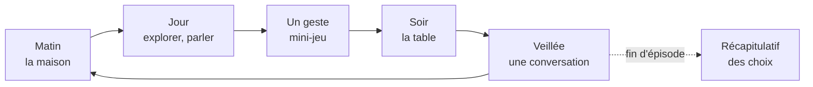

# As Long as We're Here
### *Tant qu'on est là* · Document de conception de jeu (GDD), v0.2

> « Huit bols sur la table. De quoi en remplir cinq. Tu as quatorze ans. »

---

## Sommaire

0. [Fiche signalétique](#0-fiche-signalétique)
1. [Le pitch](#1-le-pitch)
2. [Les quatre piliers](#2-les-quatre-piliers)
3. [Genre et point de vue : pourquoi ces choix](#3-genre-et-point-de-vue--pourquoi-ces-choix)
4. [Le cadre : Hollis, Kentucky, 1932-1933](#4-le-cadre--hollis-kentucky-1932-1933)
5. [La famille Caudill](#5-la-famille-caudill)
6. [Les mécaniques](#6-les-mécaniques)
7. [Structure en épisodes et fins](#7-structure-en-épisodes-et-fins)
8. [L'épisode 1 en détail](#8-lépisode-1-en-détail)
9. [Écriture et dialogues](#9-écriture-et-dialogues)
10. [Exemples d'événements](#10-exemples-dévénements)
11. [Direction artistique](#11-direction-artistique)
12. [Son et musique](#12-son-et-musique)
13. [Technique](#13-technique)
14. [Rigueur historique et représentation](#14-rigueur-historique-et-représentation)
15. [Production : prochaines étapes](#15-production--prochaines-étapes)
16. [Références](#16-références)
17. [Annexe : ordres de grandeur économiques (1932)](#annexe--ordres-de-grandeur-économiques-1932)

---

## 0. Fiche signalétique

| | |
|---|---|
| **Titre de travail** | *As Long as We're Here* (VF : *Tant qu'on est là*) |
| **Genre** | Aventure narrative en épisodes, avec gestion familiale et mini-jeux d'adresse (les « gestes ») |
| **Point de vue** | 2D de profil : la maison vue **en coupe** (comme une maison de poupée) et la vallée en défilement latéral |
| **On incarne** | Henry Caudill, 14 ans, troisième de cinq enfants |
| **Cadre** | Hollis, ville-compagnie fictive de l'est du Kentucky (Appalaches), d'octobre 1932 à septembre 1933 |
| **Format** | 4 épisodes de 25 à 40 minutes (épisode 1 jouable), choix reportés d'un épisode à l'autre |
| **Plateformes** | Navigateur (ordinateur, tablette, téléphone à l'horizontale), puis PC (Steam) |
| **Technique** | JavaScript sans dépendance, Canvas 2D, son synthétisé en Web Audio (voir §13) |
| **Public** | Adolescents et adultes. PEGI 12 à 16 visé (faim, mort, travail des enfants, alcool ; aucune violence graphique) |
| **Comparables** | *This War of Mine* (dilemmes de survie), *Night in the Woods* (petite ville, vue de profil), *Gris* (la couleur comme émotion), *Valiant Hearts* (drame historique en 2D, archives à débloquer) |

---

## 1. Le pitch

**Été 1932.** L'usine Hollis Lumber & Stave, une scierie qui fabriquait aussi des douelles de tonneaux, ferme ses grilles. Kenneth Caudill y sciait depuis vingt ans, et ses deux fils aînés l'y avaient rejoint. Henry devait y entrer l'année suivante.

**Octobre.** Les dernières économies sont parties. La famille vit dans une maison qui appartient à la compagnie et achète à crédit au magasin de la compagnie, en bons de la compagnie. Il n'y a plus de compagnie, il ne reste que ses dettes.

**Le joueur incarne Henry.** Le jour, il parcourt la vallée pour rapporter quelque chose : du poisson, du charbon tombé des wagons, quelques cents gagnés à écorcer le tabac, une cruche de moonshine livrée pour le distillateur du coin. Le soir, il rentre et pose ce qu'il a trouvé sur la table. Il y a huit bols.

Le jeu se joue en **épisodes d'une demi-heure**. Chacun couvre quelques jours de l'année 1932-1933, avec ses repas, ses gestes et ses choix, et ce que fait le joueur suit la famille d'un épisode à l'autre.

---

## 2. Les quatre piliers

Chaque mécanique, chaque écran et chaque dialogue doit servir au moins un de ces piliers. Ce qui n'en sert aucun est coupé.

1. **Huit bouches, une marmite.** La pauvreté se joue d'abord à table. Toute décision est une décision de partage : qui mange, qui se chauffe, qui part.
2. **Chaque geste raconte.** Les mécaniques sont les gestes du quotidien de 1932 : porter, pêcher, creuser, touiller, se cacher, partager. Chacun est court, différent des autres, et dit quelque chose de la vie de la famille.
3. **La dignité ou le pain.** Accepter la charité, voler, briser une grève, mentir à l'enquêtrice : survivre a un prix moral, et chaque membre de la famille ne le paie pas de la même façon.
4. **Rester ou partir.** *Qu'elle était verte ma vallée* contre *Les Raisins de la colère* : l'attachement à la terre et à la communauté face à la route. La partie se termine sur ce choix.

**Ton.** Réaliste et sobre, jamais misérabiliste. Il y a de la musique, des rires d'enfant, de l'entraide. C'est parce qu'on voit ce qu'il y a à perdre que la perte se ressent.

---

## 3. Genre et point de vue : pourquoi ces choix

### Le genre : aventure narrative en épisodes

Dans *This War of Mine*, on dirige un groupe depuis l'extérieur. Ici, on **est** l'un des enfants de la famille, pas son gestionnaire. Chaque épisode alterne trois choses :

- **Explorer et parler.** On contrôle Henry dans la maison, le camp, la montagne ou le bourg. On parle à sa famille et aux voisins ; les choix de dialogue ont des conséquences.
- **Les gestes.** Chaque activité est un mini-jeu court et différent : garder l'équilibre sur une passerelle, pêcher, identifier le ginseng, marchander, touiller en rythme, se cacher de nuit. Des QTE ponctuent les moments de tension.
- **La table.** Le soir, on partage la marmite entre huit bols. C'est la gestion du jeu, à hauteur de famille.

**Ce que le jeu n'est pas :** pas de combat, pas d'arbre de compétences, pas d'artisanat. Les gestes ne sont jamais punitifs : un échec coûte un peu de nourriture ou d'argent, jamais la partie.

### Le point de vue : 2D de profil, maison en coupe

| Option | Verdict |
|---|---|
| **2D de profil, maison en coupe** ✅ | On voit les huit membres de la famille en même temps, dans leurs gestes quotidiens, et c'est le cœur émotionnel du jeu. Le cadrage frontal rappelle les photographies de l'époque. Les vallées encaissées de l'est du Kentucky se prêtent aux compositions verticales en plans successifs. La production 2D reste à la portée d'une petite équipe. |
| Isométrique | Excellent pour la gestion, mais place le joueur en position de « dieu » au-dessus de la famille, alors qu'on est l'un de ses enfants. |
| Première personne | Intime, mais on perd la vue d'ensemble de la famille et la lisibilité de son état. Coûteux en 3D. |
| Vue de dessus | Lisible mais froide : on perd les silhouettes, les postures et la verticalité des montagnes. |

La caméra se tient **à hauteur d'enfant** : les têtes des adultes sortent souvent du cadre, les comptoirs sont hauts et la casquette du contremaître touche le haut de l'écran.


---

## 4. Le cadre : Hollis, Kentucky, 1932-1933

### Hollis

- Ville-compagnie construite par la Hollis Lumber & Stave Co. dans une vallée étroite (un *holler*) au bord de Troublesome Creek, dans les monts Cumberland. Le ruisseau existe ; la ville et le comté sont fictifs.
- La compagnie possède tout : les maisons alignées sur pilotis contre la pente, le magasin, l'école à classe unique, l'église et les bons d'achat (le *scrip*) qui servaient de salaire. L'usine est fermée et les grilles sont enchaînées. Le magasin, lui, est resté ouvert, et le loyer court toujours.
- Petite ironie amère : l'usine taillait des douelles pour des tonneaux de whiskey que la Prohibition interdit de boire. Dans les collines, le moonshine, lui, se porte bien.
- À une heure de marche, la mine n° 4 de la Black Mountain Coal Co. tourne au ralenti. Elle embauche quand ses mineurs font grève.

### Les lieux de la vallée

On les trouve sur la carte qu'Henry dessine dans son cahier d'écolier ; un lieu y apparaît dès qu'il l'a découvert.

| Lieu | Ce qu'on y fait | Marche depuis la maison |
|---|---|---|
| **La maison** | Le centre du jeu : la table, la veillée, la nuit | — |
| **Le camp** | Les voisins, l'entraide, les vols, les rumeurs | 5 min |
| **Le bourg** | Magasin de la compagnie, école, église, bureau de poste, l'usine fermée, la maison du directeur sur la colline | 20 min |
| **Le ruisseau** | Pêche, lessive, baignade en été, baptêmes | 15 min |
| **La voie ferrée** | Charbon tombé des wagons, le train de 6 h 12, le campement des hobos, le « bull » (la police de la compagnie ferroviaire) | 30 min |
| **La montagne** | Chasse, collets, cueillette, ginseng, l'alambic de Dow Slone | 45 min |
| **La mine n° 4** | Embauche, grève, piquets | 1 h |
| **La vieille ferme** | Le domaine abandonné du grand-père, en haut du vallon, à restaurer pour la route « remonter » | 2 h |
| **Le chef-lieu** | Croix-Rouge, médecin, prêteur sur gages, banque fermée, gare | Une demi-journée (ou le camion du laitier) |

### Les gens de la vallée

| Personnage | Rôle |
|---|---|
| **Les Napier** | Voisins de palier : Mrs. Napier (Nora), Abner, et une ribambelle d'enfants dont Jimmy, qui court partout. Encore plus pauvres que les Caudill, et pourtant prêteurs de haricots. |
| **Otis Hairston** | 14 ans, fils d'un mineur noir de la n° 4 venu d'Alabama. Il pêche avec Henry depuis toujours, ce que la vallée voit d'un mauvais œil. |
| **Mr. Pruitt** | Gérant du magasin de la compagnie, il tient l'ardoise. Ni bon ni méchant : il a des ordres. |
| **Miss Adair** | L'institutrice. Elle prête des livres, sert la soupe de midi et peut écrire une lettre de recommandation. |
| **Dow Slone** | Distillateur clandestin. Il paie bien et ne pose pas de questions. |
| **Frère Combs** | Prédicateur Old Regular Baptist. Réconfort, charité, et parfois jugement. |
| **L'infirmière à cheval** | Inspirée de la Frontier Nursing Service (Kentucky, fondée en 1925). Gratuite, mais elle a cinquante familles à voir. |
| **L'enquêtrice** | Envoyée par la Croix-Rouge pour vérifier que la famille « mérite » la farine. |
| **Le photographe** | Photographe de presse venu du Nord pour un reportage sur la misère des Appalaches. Il ouvre et ferme le jeu. |
| **Oncle Hiram** | Le frère de Papa, parti à Detroit. Il revient en plein hiver, les mains vides. |

### Le calendrier historique

| Date | Événement | Effet en jeu |
|---|---|---|
| Été 1932 | Fermeture de l'usine (prologue) | Tout commence |
| 8 nov. 1932 | Élection de Roosevelt | Débat à table. L'Espoir monte ou baisse selon Papa |
| 1932-1933 | La Croix-Rouge distribue la farine des surplus fédéraux de blé | Une aide sous conditions : l'enquêtrice |
| Hiver 1932-1933 | Le creux de la crise (un actif sur quatre au chômage en 1933) | L'épisode le plus dur |
| 4 mars 1933 | Investiture : « la seule chose que nous devons craindre, c'est la peur elle-même », à la radio du magasin | Espoir en hausse |
| 6-13 mars 1933 | Fermeture des banques | Le scrip et le troc reprennent de la valeur |
| Avril 1933 | Civilian Conservation Corps : 30 $ par mois, dont 25 envoyés à la famille | Wes peut partir… s'il a 18 ans et si la famille est inscrite à l'assistance |
| 16 juin 1933 | NIRA, section 7(a) : droit syndical | Les organisateurs de l'UMWA arrivent : « Le Président veut que vous rejoigniez le syndicat ! » |
| Été 1933 | Grève et affrontements à la mine | L'arc de Clay |
| 5 déc. 1933 | Fin de la Prohibition | Après la fin du jeu : le moonshine rapporte jusqu'au bout |

---

## 5. La famille Caudill

Huit personnes, huit bols. Chacun a un **trait** qui modifie ses réactions dans la simulation, des **tâches** qu'il peut accomplir et un **arc** possible, qui n'est jamais garanti.

| | Âge | Trait (effet en jeu) | Tâches | Ce qui peut lui arriver |
|---|---|---|---|---|
| **Kenneth** (Papa) | 48 | **Fier** : la charité lui coûte du Moral, et il refuse de signer pour l'assistance | Chercher du travail, couper du bois, réparer | S'effondrer (silence, boisson), partir au Nord, rejoindre le syndicat, se relever |
| **Ida** (M'man) | 43 | **Pilier** : elle se prive en secret quand la marmite manque | Lessive pour le bourg, conserves, couture | Tomber malade d'épuisement, devenir l'alliée d'Henry |
| **Granny Hattie** | 76 | **Enracinée** : elle refusera de quitter la montagne. **Guérisseuse** : remèdes de plantes | Remèdes, histoires (Espoir), garder Pearl, apprendre le ginseng à Henry | Refuser de manger pour les petits, « remonter » seule à la vieille ferme |
| **Clay** | 20 | **Colérique** | Mine, travaux de force | Briseur de grève ou syndicaliste, partir en train de marchandises, prison |
| **Wes** | 17 | **Musicien** : son violon soutient l'Espoir de toute la maison | Bois, petits boulots | Le CCC (en mentant sur son âge), vendre son violon |
| **Henry** | 14 | Le joueur | Tout ce qui se fait dans la vallée | Tenir sa promesse à Ruth, garder l'amitié d'Otis, porter ce qu'on ne devrait pas porter à 14 ans |
| **Ruth** | 11 | **Studieuse** : l'école est son espoir | Garder Pearl, couture, école | Partir chez une tante à Lexington, obtenir une bourse pour une école de mission (inspirée de la Hindman Settlement School, Knott County) |
| **Pearl** | 4 | **Fragile** : a besoin de lait, tombe malade vite | Rire (fait monter l'Espoir) | Fièvre, pellagre. En plein hiver, le comté propose l'orphelinat |

**Silhouettes** (chaque membre doit se reconnaître en ombre chinoise) : Papa, grand et voûté sous un chapeau mou. M'man, tablier et châle. Granny, petite, bonnet et pipe en épi de maïs. Clay, casquette et manches retroussées. Wes, long et maigre, le violon sous le bras. Henry, dans une salopette trop grande héritée de Wes. Ruth, des nattes et un livre. Pearl, une robe taillée dans un sac de farine imprimé.

---

## 6. Les mécaniques

Quatre mécaniques principales et deux systèmes transversaux, chacun relié à un pilier.

| | Mécanique | Pilier |
|---|---|---|
| 6.1 | **La Table** : partager la marmite | Huit bouches |
| 6.2 | **Les gestes** : un mini-jeu par activité | Chaque geste raconte |
| 6.3 | **La Maison** : huit vies sous un toit | Huit bouches, dignité |
| 6.4 | **L'Ardoise** : dette, loyer et objets de famille | Dignité, rester ou partir |
| 6.5 | *L'Espoir* : la vallée qui perd ses couleurs | Tous |
| 6.6 | *L'Entraide* : la mémoire du camp | Dignité, rester |

### 6.0 La boucle d'un épisode



| Phase | Durée | Ce qui s'y passe |
|---|---|---|
| **Matin** | 1 à 3 min | La maison en coupe. On parle à qui on veut ; quelqu'un donne la mission du jour. |
| **Jour** | 3 à 6 min | Un lieu à parcourir (camp, montagne, bourg), des rencontres, un choix ou deux. |
| **Le geste** | 2 à 4 min | Le mini-jeu de la journée. Les dialogues s'y glissent entre deux prises, deux racines, deux couplets. |
| **Soir : la Table** | 2 à 3 min | On partage la marmite. Les tensions de la famille éclatent à table. |
| **Veillée** | 1 à 2 min | Une seule conversation par soir, avec la personne de son choix. Puis on dort. |

### 6.1 La Table : partager la marmite

**Principe.** Tout ce qu'on cuisine forme la marmite, mesurée en **bols**. Chaque soir, il faut remplir huit bols.

**Règles**
- Chaque membre a besoin d'**un bol par jour**. Pearl, d'un demi. Un adulte qui a fait un travail de force, d'un et demi.
- Le joueur verse les louches dans les bols d'un clic (une louche = un demi-bol) et peut en reprendre. Un bol vide reste posé sur la table, et il se voit.
- La **Faim** de chacun suit cinq crans : *Rassasié → Faim → Affamé → Épuisé → Mourant*. Un bol plein la fait descendre d'un cran, un demi-bol la laisse stable, un bol vide la fait monter d'un cran.
- **La variété et la pellagre.** Chaque aliment porte une étiquette : *Grain*, *Gras*, *Haricots*, *Verdure*, *Viande et poisson*, *Lait et œufs*. Quelqu'un qui ne mange que du Grain et du Gras pendant plus de six jours accumule un risque de pellagre : fatigue, peau brûlée, confusion. C'était une vraie maladie des régimes à base de maïs dans le Sud des années 1930. La levure de bière, le lait, la viande et la verdure la font reculer. Rapporter de l'argent pour acheter du maïs ne suffit donc pas : il faut aussi pêcher, chasser et cueillir.
- **Ce qu'on ne dit pas.** Quand la marmite est trop petite, Ida se prive en secret (« j'ai goûté en cuisinant »), et Granny refuse son bol « pour la petite ». Le jeu ne l'affiche nulle part. Il faut le remarquer : un bol propre, un geste discret quand tout le monde a le nez dans son assiette, une question posée à la veillée. Une fois qu'il en a parlé à Ida, elle mange.
- **Qui sert ?** L'histoire le décide. Le premier soir, c'est Papa : le joueur regarde, et ne contrôle que son propre bol, qu'il peut partager. Quand Papa n'est pas là, M'man tend la louche à Henry : « Sers, toi. Moi, j'ai plus le cœur à compter. »

**Ce que ça fait ressentir :** compter. Chaque soir, le joueur compte les bols à voix basse, comme Ida.

### 6.2 Les gestes : un mini-jeu par activité

**Principe.** Chaque activité d'Henry est un geste du quotidien de 1932, joué comme un court mini-jeu. Aucun ne se répète dans un même épisode.

**Règles communes**
- **Court** : 1 à 4 minutes, avec une consigne claire et un essai quand c'est nécessaire.
- **Jouable partout** : souris, doigt ou clavier. Rien ne dépend du survol.
- **Jamais bloquant** : un échec coûte une gamelle, un poisson ou quelques cents, jamais la partie. Après plusieurs échecs, le jeu laisse passer.
- **Habité** : les dialogues se glissent dans le geste (Otis parle entre deux prises, Granny commente chaque racine, les voisins bavardent entre deux couplets).
- **Des QTE aux moments de tension** : s'accrocher au câble quand la passerelle rebondit, ferrer quand le bouchon s'enfonce, rattraper un bocal qui glisse.

**Les gestes de l'épisode 1**

| Geste | Mécanique | Ce qu'il raconte |
|---|---|---|
| **La passerelle** | Équilibre (pendule inversé, rafales, QTE) | Porter le repas des hommes, le dernier jour de l'usine |
| **La liste de M'man** | Budget : 40 ¢, une liste, la tentation du crédit | Chaque cent compte, et le magasin de la compagnie le sait |
| **La pêche avec Otis** | Lancer dosé, ferrer au bon moment, tension de ligne | L'amitié par-dessus la ligne de couleur du camp |
| **La Table** | Partage des louches entre huit bols | Qui mange, qui se prive |
| **Le sang (ginseng)** | Observation (vrais et faux plants), puis fouille délicate de la racine | Le savoir de Granny, la terre qu'on respecte |
| **Le marchand de racines** | Pousser sa chance face à un acheteur qui s'agace | La valeur des choses quand on est pauvre |
| **Le beurre de pommes** | Rythme sur le reel joué par Wes, trois tempos | La joie qui existe encore, et la communauté |
| **La livraison** | Infiltration de nuit : bruit des bocaux, lanterne de l'agent, chien, gué | Ce qu'on accepte de faire pour payer le loyer |
| **La photo des huit** | Composer la photo (glisser-déposer), puis « Ne bougez plus » : ne rien toucher | Le seul souvenir que la famille gardera |

### 6.3 La Maison : huit vies sous un toit

**Trois états par personne** : la **Faim**, la **Santé** (*Bien portant → Malade → Gravement malade → Mourant*, plus des affections : rhume, pneumonie, pellagre, dysenterie, blessure) et le **Moral** (*Serein → Triste → Abattu → Brisé*).

**Une lecture diégétique.** On ne lit pas des chiffres, on regarde la maison : les silhouettes maigrissent (trois stades par personnage), les postures s'affaissent, on entend une toux dans la nuit, et un jour Papa ne rentre plus du perron. Le cahier d'Henry donne la version écrite de tout cela pour qui en a besoin (accessibilité).

**Ce que fait chacun.** Les autres membres de la famille vivent leur vie entre les scènes : Papa et Clay cherchent du travail à Hazard, Wes scie du bois pour Pruitt, Ida fait la lessive du docteur, Ruth va à l'école. Ce qu'ils rapportent, et ce qu'ils ont fait pour le rapporter, se découvre à table et le samedi, au moment de payer le loyer.

**L'autonomie.** Un membre au Moral bas peut refuser une tâche, ou agir de lui-même : Clay file à la réunion syndicale, Papa boit les derniers cents.

**La veillée.** Une seule conversation par soir. C'est là qu'on découvre ce qu'on ne dit pas, qu'on console (le Moral remonte) et qu'on gagne la confiance de chacun.

**Le froid.** La maison consomme chaque jour du combustible selon la température. Quand il manque, on brûle les meubles : les chaises disparaissent et on s'assoit sur des caisses. Ensuite viennent les maladies.

**Les soins**

| Option | Coût | Efficacité |
|---|---|---|
| Les remèdes de Granny | Gratuits | Incertaine |
| L'infirmière à cheval | Gratuite | Bonne, mais elle passe dans 2 ou 3 jours |
| Le médecin du chef-lieu | 2 $ comptant et une demi-journée de marche | Bonne, et immédiate |
| La levure de bière (contre la pellagre) | Quelques cents, ou la Croix-Rouge | Bonne |

**Les départs.** On peut perdre quelqu'un sans qu'il meure : Clay saute dans un train de marchandises, Wes part au CCC, Ruth est envoyée chez une tante, Pearl à l'orphelinat du comté, Papa au Nord, Granny remonte à la vieille ferme. Chaque départ soulage la marmite et laisse une place vide à table. Ceux qui sont partis peuvent écrire (un mandat, des nouvelles)… ou se taire.

**La mort.** Elle existe, mais n'arrive jamais hors champ. Une maladie mortelle se voit venir pendant plusieurs jours, et la mort survient toujours au cours d'une journée jouée. Puis la partie continue.

### 6.4 L'Ardoise : dette, loyer et objets de famille

**Principe.** La dette est l'horloge du jeu. Elle avance même quand on ne fait rien.

- **Le loyer.** La maison appartient à la compagnie : 8 $ par mois, dus le 1er.
- **L'ardoise du magasin.** On peut acheter à crédit au magasin de la compagnie, à des prix 30 % plus chers qu'à l'épicerie du chef-lieu. Mais l'épicerie est loin et ne fait pas crédit. Le loyer impayé s'ajoute à l'ardoise.
- **Les seuils.** Au-delà de 25 $, Mr. Pruitt coupe le crédit. Au-delà de 40 $ arrive un avis d'expulsion, puis la visite de l'adjoint du shérif, puis l'expulsion : les meubles sur la route, image emblématique de l'époque.
- **L'expulsion n'est pas un *game over*.** Elle force le départ, vers la vieille ferme ou le campement de tentes au bord de la voie, dans les pires conditions.
- **Le scrip** ne vaut rien hors du magasin de la compagnie. Ailleurs, on l'échange à 70 % de sa valeur, quand on trouve preneur.
- **Le troc** (œufs, ginseng, charbon, moonshine, travail) est l'économie réelle de la vallée.

**Les objets de famille.** Chacun a un usage ou soutient le Moral de quelqu'un. Les vendre au prêteur sur gages rapporte de l'argent, et laisse un vide visible dans la maison : une marque plus claire sur le mur, là où pendait le violon.

| Objet | Ce qu'il apporte | Qui en souffre s'il est vendu |
|---|---|---|
| La montre de Papa | — | Papa (beaucoup) |
| Le violon de Wes | Soirées de musique (Espoir) | Wes, et toute la maison se tait |
| L'alliance d'Ida | — | Ida, en silence |
| Le quilt de Granny | De la chaleur l'hiver | Granny |
| La carabine .22 | La chasse | Personne, mais plus de viande |
| La Bible familiale | Les naissances y sont inscrites | Invendable : personne ne l'achèterait |

### 6.5 L'Espoir : la vallée qui perd ses couleurs

- L'**Espoir** est la moyenne du Moral de la famille, et c'est la valeur la plus visible du jeu : **il règle la saturation de l'image**. Espoir haut : les rouilles et les ocres de l'automne appalachien, le vert tendre du printemps. Espoir bas : la vallée glisse vers le sépia des photographies d'époque. *Qu'elle était verte ma vallée*, au sens littéral.
- Il règle aussi **la musique** : les couches instrumentales disparaissent une à une (le banjo, puis le violon, jusqu'à ce qu'il ne reste qu'une voix), ainsi que la probabilité de certains événements (boisson, disputes, départs).
- **Ce qui le nourrit :** les soirées de musique (si le violon n'est pas vendu), le culte du dimanche, les lettres de ceux qui sont partis, un repas complet, un anniversaire, la radio du magasin le 4 mars 1933, les premières verdures du printemps, une histoire racontée à Pearl.
- **Accessibilité :** l'information n'est jamais portée par la seule couleur. Postures, musique et cahier la redoublent.


### 6.6 L'Entraide : la mémoire du camp

> Si t'as des ennuis, va voir les pauvres gens : y a qu'eux qui t'aideront.
> — d'après Ma Joad, *Les Raisins de la colère*

- Chaque foyer du camp garde une **mémoire des services** : ce que les Caudill lui ont donné, et ce qu'ils lui ont pris.
- **Donner quand on n'a presque rien** coûte cher tout de suite et rapporte plus tard, au moment où on en a le plus besoin : les Napier rapportent un bol de haricots le lendemain des cinq cents donnés au magasin (épisode 1), du lait pendant la fièvre de Pearl, les voisins se massent devant la maison le jour où l'adjoint vient expulser, les hobos préviennent Henry que le bull a changé d'horaire.
- **La trahison laisse des traces** : briser la grève, dénoncer un voleur, voler un voisin.

---

## 7. Structure en épisodes et fins

### Les épisodes

| | Période | Durée visée | Ce qui pèse | Moments forts |
|---|---|---|---|---|
| **1. Le dernier sifflet** | Août et octobre 1932 | 25 à 35 min | L'argent, le loyer, la dignité | La fermeture de l'usine, le ginseng avec Granny, le beurre de pommes, la livraison de nuit, la photo des huit (détail au §8) |
| **2. Le charbon des voies** | Décembre 1932 | 30 à 40 min | Le froid, la faim, la maladie | Le charbon tombé des trains, un Noël sans oranges, l'enquêtrice de la Croix-Rouge, le retour d'Oncle Hiram, la fièvre de Pearl |
| **3. La verdure** | Mars-avril 1933 | 30 à 40 min | La dignité, les premiers choix | Le 4 mars à la radio, la fermeture des banques, les premières verdures, le CCC pour Wes, la crue de printemps |
| **4. Les lucioles** | Juillet-août 1933, puis septembre | 30 à 40 min | Le conflit, le choix final | La grève de la n° 4, le *revival* sous la tente, la décision (rester, remonter ou partir), la deuxième photo |

### Le temps

- Un épisode couvre quelques jours. Chaque journée jouée dure de 5 à 10 minutes ; les jours sans événement sont racontés en une ligne (« Le mercredi, il plut toute la journée »).
- Entre deux épisodes, plusieurs semaines passent. Le début de l'épisode suivant dit ce qu'elles ont fait à la famille, en fonction des choix de l'épisode précédent (loyer payé ou non, Clay briseur de grève ou non, Dow Slone, Otis…).
- **Règle : personne ne meurt entre deux épisodes.** L'entre-deux peut aggraver un état, mais la conséquence se joue toujours à l'écran.
- Fin d'épisode : un **récapitulatif des choix** (à la manière des jeux narratifs à épisodes), avec la photo de famille.

### Les trois routes

Toute l'année, le joueur prépare (ou subit) l'une de ces trois issues :

- **Rester à Hollis.** Garder la maison (l'ardoise sous contrôle) et trouver un revenu : la mine sous contrat syndical, l'assistance, le mandat du CCC. *Qu'elle était verte ma vallée* : la communauté, la mine, la mémoire.
- **Remonter à la vieille ferme.** Restaurer le domaine du grand-père, à deux heures de marche en haut du vallon : le toit, la clôture, les semences, le potager, peut-être une vache. C'est un chantier long, qui vole des journées à la survie immédiate. L'autarcie, l'isolement, la terre. Granny ne veut que ça.
- **Partir vers le Nord.** Detroit, Akron ou Dayton. Il faut de l'argent pour le voyage (ou les trains de marchandises), une adresse, et accepter que Granny ne viendra pas. Oncle Hiram, revenu de Detroit les mains vides, rappelle que la route ne promet rien. *Les Raisins de la colère*.

### La photo finale

**À la fin de l'épisode 1**, le photographe de presse photographie la famille. Papa refuse d'être « montré comme un pauvre » : selon ce que dit Henry, il cède, ou il reste derrière la porte, et la photo n'a que sept personnes. Ce sera la seule photo de la famille.

**À l'épilogue**, il revient en septembre 1933 et reprend le même cadrage. Le jeu se termine sur cette deuxième photo, composée par la simulation :
- **Le lieu** : le perron de Hollis, la vieille ferme ou un trottoir de Detroit.
- **Les présents** : ceux qui sont encore là. Les absents vivants sont représentés par une lettre dans la main d'Ida ; les morts, par une place que personne n'a comblée.
- Puis le vieil Henry dit, en quelques lignes, ce que chacun est devenu.

**Trois exemples de fins**
- **Le perron de Hollis.** Sept sur la photo, Granny est morte en février. Henry se tient à côté d'Ida ; la lettre de Papa, partie de Detroit, est dans sa main. *« J'ai pris la place de mon père à la n° 4 en 1934. J'y suis resté trente et un ans. Ruth, elle, est devenue institutrice. »*
- **La vieille ferme.** Huit sur la photo, Henry pieds nus au milieu des petits. *« On a eu faim encore longtemps. Mais on a eu faim ensemble. »*
- **Un trottoir de Detroit.** Cinq sur la photo : Granny est restée sur sa montagne, Clay est en prison à Harlan, Pearl repose au cimetière de Hollis. *« Je n'ai jamais revu la vallée verte. Je ne suis pas sûr qu'elle l'ait jamais été. »*

**Philosophie de difficulté : la partie ne se gagne pas, elle se traverse.** La fin parfaite (huit sur la photo, personne n'a faim, aucune compromission) existe, mais elle doit rester rare. Un **mode récit**, moins exigeant, est proposé à ceux qui viennent surtout pour l'histoire.

---

## 8. L'épisode 1 en détail

**« Le dernier sifflet »** · août et octobre 1932 · environ 30 minutes · jouable (dossier `game/`).

| # | Scène | Ce qu'on fait | Mécanique | Choix qui comptent |
|---|---|---|---|---|
| 1 | **Ouverture** | La voix du vieil Henry : « On était huit, cet été-là. » | Narration | — |
| 2 | **Prologue : la maison** (12 août 1932, midi) | M'man confie les trois gamelles ; Granny, Ruth et Pearl (« Hier je suis arrivée jusqu'à onze ! ») | Exploration de la maison en coupe | — |
| 3 | **Le camp** | Traverser le camp en été : Mrs. Napier, le petit Jimmy, Pruitt, Otis | Exploration de profil | Promettre la pêche à Otis |
| 4 | **La passerelle** | Traverser le pont suspendu sans perdre de gamelle | Équilibre + QTE « Accroche-toi au câble ! » | Les gamelles perdues changent les répliques à l'usine |
| 5 | **La scierie** | Donner les gamelles à Papa, Clay et Wes ; l'annonce de la fermeture ; le dernier sifflet, très long | Exploration, dialogues, choix minuté | Prendre la main de Papa, regarder Clay, ne rien faire |
| 6 | **Deux mois plus tard** (lundi 17 octobre) | Six heures : le silence à l'heure du sifflet. M'man donne 40 ¢ et annonce le loyer de samedi : 8 $ | Exploration, 7 conversations | Promettre à Ruth qu'elle restera à l'école ; imiter le sifflet pour Pearl |
| 7 | **Le magasin de la compagnie** | Mrs. Napier se voit refuser le crédit devant Henry. Puis les courses | Budget, crédit | Donner 5 ¢ à Mrs. Napier ; acheter du pétrole, du café, un sucre d'orge ; prendre à crédit malgré M'man |
| 8 | **La pêche avec Otis** | Pêcher au trou de la Barbue en parlant de la grève et du camp d'en haut | Lancer, ferrer, tension de ligne | Partager le plus beau poisson avec Otis |
| 9 | **La première table** | Papa sert. S'il manque, il se sert une demi-louche, et le bol de M'man reste propre. Clay et Papa se disputent sur la Black Mountain | La Table (regarder), choix minuté | Donner la moitié de son bol ; remarquer le bol de M'man ; soutenir Clay, Papa ou se taire |
| 10 | **La veillée** | Une conversation au choix parmi sept (Wes joue « Shady Grove » sur trois cordes, une histoire pour Pearl…) | Exploration de nuit | Confronter M'man ; consoler Papa |
| 11 | **La montagne** (mardi) | Monter avec Granny, qui raconte la vieille ferme | Marche et conversations | — |
| 12 | **Le sang** | Trouver le ginseng parmi les leurres, puis dégager la racine sans la casser | Observation + fouille délicate | Replanter les baies |
| 13 | **Dow Slone** | L'alambic, et la proposition : six bocaux à livrer vendredi pour 2 $ | Dialogue | Accepter, refuser, ou laisser Granny répondre |
| 14 | **La deuxième table** | Papa et Clay sont à Hazard. « Sers, toi. » Les Napier rapportent des haricots si on les a aidés | La Table (servir) | Insister pour que Granny mange ; voir ou non M'man verser son bol dans celui de Pearl |
| 15 | **La veillée** | Granny et la source qui « demande jamais de loyer », Wes et son violon à vendre… | Exploration de nuit | Parler de la vieille ferme ; pousser Wes à vendre son violon |
| 16 | **Le bourg** (jeudi) | Vendre les racines ; rencontrer M. Whitcomb, le photographe | Marchandage + dialogue | Ce qu'on dit au journaliste : « On s'en sort », « On a faim », ou rien |
| 17 | **Le beurre de pommes** | Toute la nuit chez les Napier, Wes au violon. Otis regarde le feu depuis la clôture | Rythme (3 tempos) | Porter une cuillère à Otis |
| 18 | **Vendredi soir** | M'man compte : il manque de l'argent | Choix | Aller au gros sycomore… ou laisser Clay y aller |
| 19 | **La livraison** | Traverser les bois de nuit avec six bocaux | Infiltration + QTE | — |
| 20 | **Samedi : le loyer** | Chacun pose ce qu'il a sur la table ; Papa demande d'où vient l'argent ; M. Farris passe | Dialogue | Mentir à Papa ou dire la vérité ; délai ou ardoise |
| 21 | **La photo des huit** | Convaincre Papa ou non, composer la photo, puis « Ne bougez plus » | Glisser-déposer + ne rien toucher | Huit ou sept sur la photo |
| 22 | **Fin** | Le vieil Henry, puis le récapitulatif des choix et la photo | Récapitulatif | — |

**Ce qui passe à l'épisode 2 :** le loyer (payé, ardoise, avertissement), la faim de chacun, l'Espoir, et les décisions marquantes (Mrs. Napier, Otis, Dow Slone, Clay et la Black Mountain, la vérité dite à Papa, les baies replantées, la photo).

## 9. Écriture et dialogues

- **Peu de texte, beaucoup de gestes.** Des dialogues courts et secs, avec un humour pudique. Personne ne fait de discours sur la crise : on parle de bols, de charbon et de chaussures.
- **Un narrateur : le vieil Henry**, des décennies plus tard, comme dans *Qu'elle était verte ma vallée*. Il n'intervient qu'à l'ouverture et à la fin des épisodes, et pendant les ellipses.
- **Le registre** : un français oral et rural, sans caricature (« Pap' », « M'man », « Granny »). Pas de patois inventé, pas d'orthographe phonétique. En anglais, le parler appalachien sera documenté et relu par des locuteurs.
- **Les choix de dialogue ont des conséquences** (Moral, Entraide, suite des épisodes), suggérées par le ton plutôt que par des icônes. Certains choix sont **minutés** : se taire est aussi une réponse.

### Extraits

**Ouverture de l'épisode 1 (le vieil Henry)**
> On était huit, cet automne-là. Je le sais parce que M'man comptait les bols tous les soirs, à voix basse, comme on compte ses enfants sur un quai de gare. Huit. Elle disait : tant qu'on est là, tous les huit, il peut rien nous arriver.
> Elle se trompait, bien sûr. Mais pas sur tout.

**La première table (Papa sert)**
> *Papa remplit les bols. Arrivé au sien, il n'y verse qu'une demi-louche.*
> **RUTH** — T'en as presque pas, Pap'.
> **PAPA** — J'ai pas travaillé aujourd'hui. Un homme qui travaille pas a pas besoin de manger comme un homme qui travaille.
> *Personne ne répond. Clay repose sa cuillère.*
>
> → *Donner la moitié de ton bol à Pearl* · *Manger* · « Moi non plus, j'ai pas travaillé. »

**La veillée avec M'man**
> **HENRY** — M'man, t'as mangé ?
> **IDA** — J'ai goûté en cuisinant. Va te coucher, t'as l'école demain.
>
> *(Si Henry l'a observée pendant le repas)* → « Je t'ai regardée. T'as rien goûté du tout. »
> **IDA** — … Les petits d'abord, Henry. Ça a toujours été comme ça.
> *(Le lendemain soir, M'man mange vraiment.)*

**Clay et Papa**
> **CLAY** — La Black Mountain embauche. Un dollar cinquante la journée, payé comptant.
> **PAPA** — Elle embauche parce que les hommes de la n° 4 sont en grève. Tu prendras pas le pain d'un homme qui se bat pour le sien.
> **CLAY** — Et ce pain-là, Pap', il est où ? Dans le bol de Pearl ?
>
> → *Soutenir Clay* · *Soutenir Papa* · *Se taire*

**Wes et le CCC**
> **WES** — Trente dollars par mois, Henry. Vingt-cinq qu'ils envoient direct à M'man. Faut juste avoir dix-huit ans… et que Pap' signe les papiers de l'assistance.
> **HENRY** — T'as dix-sept ans.
> **WES** — J'en aurai dix-huit le jour où je l'écrirai.

**Oncle Hiram, revenu de Detroit**
> **HIRAM** — Ford a fermé la moitié de son usine. Là-haut, les gens font la queue pour la soupe en costume-cravate. Y a rien là-bas, Kenneth. Rien que du froid qui coûte plus cher qu'ici.

---

## 10. Exemples d'événements

Les événements sont écrits comme des scripts de dialogue avec conditions et effets (voir `game/src/story/`). En voici six, pour les épisodes à venir.

**L'orange de Noël** *(hiver)*
Chaque année, la compagnie offrait une orange et un sachet de bonbons à chaque enfant du camp. Pas cette année. Pearl a quatre ans, et elle s'en souvient quand même.
- Échanger le couteau d'Henry au magasin contre une orange : Pearl et l'Espoir en hausse, Henry perd son couteau (et le collet qui va avec).
- Voler une orange dans la caisse livrée chez le directeur : risqué, l'Espoir monte fortement si ça marche, et la honte d'Ida si ça se sait.
- Sculpter un jouet en bois : un geste de plus le 24 décembre, l'Espoir en hausse.
- Ne rien faire. Pearl ne demande rien, et c'est pire.

**L'enquêtrice** *(hiver)*
Avant de distribuer la farine, la Croix-Rouge envoie une enquêtrice. Le violon de Wes est accroché au mur et la montre de Papa posée sur la cheminée. « Vous avez des biens à vendre, madame Caudill. »
- Cacher le violon et la montre avant sa visite (possible si les voisins ont prévenu Henry) : farine obtenue, mais le mensonge coûte à Papa.
- Les vendre d'abord : de l'argent, moins d'Espoir.
- Montrer la maison telle qu'elle est : la farine peut être refusée, mais Papa garde sa fierté.
- Papa refuse de la laisser entrer : pas de farine.

**Le train de 6 h 12** *(hiver)*
Le train de charbon ralentit dans la côte de Lick Branch. Il y a un nouveau bull, et on dit qu'il cogne.
- Grimper sur le wagon (geste d'infiltration) : trois jours de charbon. Si Henry est pris : des coups, la Santé baisse.
- Ramasser le long des voies : une demi-journée de charbon, sans risque.
- Demander aux hobos l'horaire de ronde du bull (si l'Entraide le permet).

**La fièvre de Pearl** *(toute saison)*
Pearl brûle depuis la nuit.
- Le médecin du chef-lieu : 2 $ comptant et une demi-journée de marche (le laitier peut emmener Henry contre un service).
- L'infirmière à cheval : gratuite, elle passera « dans deux ou trois jours ».
- Le remède de Granny (tisane d'eupatoire perfoliée, cataplasme d'oignon) : gratuit, résultat incertain.
- Prier au culte avec M'man : l'Espoir monte, rien de plus.

**Les poules** *(automne)*
Deux poules ont disparu. Au matin, Henry trouve des plumes devant la porte des Napier, dont les six enfants n'ont pas mangé depuis deux jours.
- Aller réclamer : l'Entraide avec les Napier s'effondre, une poule peut-être récupérée.
- Le dire à Papa : il ira, et ça finira mal.
- Ne rien dire : les Napier savent que tu sais.
- Leur apporter les œufs de la dernière poule : l'Entraide monte fortement, la marmite baisse.

**Un dollar cinquante la journée** *(été)*
La n° 4 est en grève. La Black Mountain embauche des remplaçants, payés comptant et pas en scrip. Clay tient le piquet de grève.
- Wes y va : beaucoup d'argent, mais le camp ne pardonne pas, et Clay et Wes ne se parlent plus.
- Henry y va. Il a 14 ans, c'est interdit, mais pendant une grève personne ne vérifie : de l'argent, le mépris du camp, c'est dangereux.
- Personne n'y va : le Moral de Clay monte, la marmite attend.
- Henry porte à manger au piquet : l'Entraide monte, et la confiance de Clay aussi.

---

## 11. Direction artistique

### Intention : « une photographie de 1932 qui se souvient d'avoir été en couleurs »

- **Technique** : 2D peinte (gouache et fusain), texture de papier, grain photographique léger, vignettage. Les personnages sont animés en 2D squelettique (découpage) avec des visages simples : l'émotion passe par la posture.
- **La couleur, c'est l'Espoir** (voir 6.5). Chaque saison a sa palette, et toutes tendent vers le même sépia.
- **La lumière** : les nuits d'hiver, la seule couleur chaude de l'écran est la lueur du poêle et de la lampe à pétrole. Le foyer, au sens propre.
- **La maison s'use.** Les objets vendus laissent leur marque sur le mur, les chaises brûlées sont remplacées par des caisses, les vêtements se couvrent de pièces au fil des mois. Les robes sont taillées dans des sacs de farine imprimés, comme à l'époque, où les minoteries imprimaient leurs sacs de motifs pour cette raison.
- **Les personnages** doivent être reconnaissables en ombre chinoise : on doit identifier chaque membre de la famille en noir pur. Chacun a trois stades de maigreur.
- **La représentation** : jamais de caricature « hillbilly » (pieds nus comiques, cruche marquée XXX, dents manquantes pour faire rire). Les Appalaches ont assez été moquées. On montre ces gens comme Walker Evans les photographiait : de face, avec respect.

### Palettes


| Palette | Teintes |
|---|---|
| **Automne** | rouille `#7A2E1A` · ocre `#B8732A` · hickory doré `#D9A441` · tabac `#5C4A33` · ciel d'octobre `#9AA5A0` |
| **Hiver** | charbon `#1C1D21` · ardoise `#3B4654` · brume froide `#7D8A96` · neige sale `#D8D4C8` · braise du poêle `#E37A2C` |
| **Printemps** | mousse `#5E7A3A` · pousse `#A3BE6E` · gainier `#B4527A` · cornouiller `#EEEADB` · boue `#6E5843` |
| **Été** | vert lourd `#2F4A26` · feuillage `#6F8F3F` · brume de chaleur `#CFC9A0` · luciole `#E9E27A` · ciel d'orage `#4F5864` |
| **Sépia (Espoir à zéro)** | encre `#1F1A17` · terre d'ombre `#4A3F35` · bistre `#7A6A58` · sépia clair `#B3A38A` · papier `#E8DFCC` |

### Une interface diégétique

- **Le cahier d'écolier d'Henry** sert de menu, de journal et de carte : des plans dessinés au crayon, des listes rayées, les dates.
- **Les ressources se voient dans la maison** : l'étagère du garde-manger (bocaux, sacs), le tas de bois et le seau à charbon, la boîte à café où dort l'argent, l'ardoise tenue par Mr. Pruitt.
- **Les typographies** : du crayon pour le cahier, de la machine à écrire pour les courriers officiels (avis d'expulsion, lettre du CCC), les lettrages des affiches et des journaux de 1932 pour les titres.

---

## 12. Son et musique

- **La musique traditionnelle des Appalaches** : banjo *clawhammer*, violon, dulcimer des Appalaches, chant a cappella. On puise dans le répertoire traditionnel du domaine public (les ballades anglo-écossaises conservées dans les montagnes, *Barbara Allen*, *Wayfaring Stranger*, *Shady Grove*, *Man of Constant Sorrow*), complété par des compositions originales.
- **Une musique dynamique** réglée par l'Espoir (voir 6.5).
- **La musique dans le monde du jeu** : Wes au violon (s'il le vend, la maison se tait), Granny qui chante en cousant, les cantiques « lignés » des Old Regular Baptists à l'église (le prédicateur dit la ligne, l'assemblée la reprend lentement), les chants syndicaux à la mine. *Which Side Are You On?* a été écrite en 1931 dans le comté de Harlan ; ses droits sont à vérifier, et on écrira une chanson originale si nécessaire.
- **Le son du silence.** Pendant vingt ans, le sifflet de l'usine a rythmé la vallée. Le premier matin de l'épisode 1, à l'heure où il sonnait, on n'entend rien. Le joueur ne le remarque peut-être pas. Papa, si : il est debout sur le perron, à l'heure.
- **Les ambiances** : le ruisseau, les trains de charbon, l'engoulevent bois-pourri la nuit, la toux dans la chambre d'à côté, le poêle qui craque.

---

## 13. Technique

### Choix

Pour livrer des épisodes jouables tout de suite, sur n'importe quel appareil, le jeu est une **page web autonome**.

| Besoin | Choix | Pourquoi |
|---|---|---|
| Plateforme | **Navigateur** | Jouable sans installation, par un simple lien ; un emballage bureau (Electron ou Tauri) reste possible pour Steam |
| Langage | **JavaScript sans dépendance** (scripts classiques) | Aucun outil de compilation obligatoire ; le jeu s'ouvre même depuis un fichier local |
| Rendu | **Canvas 2D**, résolution logique 1280 × 720 | Silhouettes et décors dessinés par le code ; les décors statiques sont mis en cache |
| Son | **Web Audio**, entièrement synthétisé | Banjo et dulcimer par synthèse de cordes pincées (Karplus-Strong), violon, sifflet à vapeur, ambiances (ruisseau, vent, grillons, feu) |
| Écriture | Scripts de dialogue en données (`game/src/story/`) | Répliques, choix (minutés ou non), conditions et effets, faciles à relire et à traduire |

### Architecture (`game/`)

```
src/core.js      boucle, entrées (souris, toucher, clavier), scènes asynchrones, fondus
src/state.js     famille, faim, moral, argent, garde-manger, choix ; sauvegarde locale
src/art.js       silhouettes animées (marche, assis, accroupi, parole), décors, grain
src/ui.js        texte, boutons, carnet d'Henry, notifications
src/dialog.js    répliques, narration, cartons, choix, interprète de scripts
src/audio.js     ambiances, musiques, bruitages
src/walk.js      scène d'exploration de profil (marcher, parler, interagir)
src/scenes/      décors partagés et un fichier par mini-jeu
src/story/       textes de l'épisode
src/episode1.js  le déroulé de l'épisode, avec points de sauvegarde
tools/build.mjs  génère index.html, dev.html (chaque scène seule) et dist/ (un seul fichier)
tools/shot.mjs   pilote Chromium pour les captures et les tests
```

### Points techniques notables

- **Deux canvas superposés.** Le décor reçoit le filtre de l'Espoir (saturation, sépia) ; l'interface reste nette.
- **Scènes asynchrones.** Le déroulé d'un épisode s'écrit comme un récit (`await G.play(scène)`, `await G.run(dialogue)`), ce qui garde l'épisode lisible d'un bout à l'autre.
- **Tests automatiques.** `autotest.html` joue l'épisode entier tout seul avec des choix aléatoires, journalise chaque réplique et chaque erreur ; chaque mini-jeu se teste seul dans `dev.html#nom`.
- **Sauvegarde** automatique à chaque point de passage (stockage local du navigateur), reprise depuis l'écran titre.
- **Animation** : cycle de marche, respiration, poses, et animation de parole (tête et gestes) pour celui qui parle.

## 14. Rigueur historique et représentation

- **Les Archives.** Comme dans *Valiant Hearts*, des notes historiques se débloquent en jouant, liées aux mécaniques (le scrip, la pellagre, le CCC, la farine de la Croix-Rouge, les robes en sacs de farine), illustrées de photographies du domaine public. La collection FSA/OWI de la Bibliothèque du Congrès date de quelques années après le jeu, mais documente les mêmes communautés.
- **Des relectures de sensibilité** sur trois sujets : la représentation des Appalaches, la place des mineurs noirs et la ségrégation dans les camps, et le travail des enfants. On consultera des historiens spécialistes des Appalaches, par exemple au Loyal Jones Appalachian Center du Berea College.
- **Pas de misérabilisme.** On ne joue pas avec la souffrance pour elle-même : chaque scène dure le temps qu'il faut, sans complaisance.
- **Les chiffres économiques** de ce document sont des ordres de grandeur, à valider avec un historien.

---

## 15. Production : prochaines étapes

| Étape | État | Contenu |
|---|---|---|
| **Épisode 1 : Le dernier sifflet** | Jouable | 22 scènes, 9 gestes, environ 30 minutes |
| **Relecture et réglages de l'épisode 1** | À faire | Équilibrage des gestes et du loyer, relecture des dialogues, retours de joueurs |
| **Épisode 2 : Le charbon des voies** | À écrire | Charbon des trains (infiltration et timing), Noël, l'enquêtrice, la fièvre de Pearl, Oncle Hiram |
| **Épisodes 3 et 4** | À écrire | Printemps et été 1933, le choix final et la deuxième photo |
| **Version anglaise** | À prévoir | Les textes sont regroupés par épisode pour faciliter la traduction |

**Risques identifiés**
- **Répétitivité** : la parer en ne réutilisant jamais un geste dans un même épisode, et en faisant évoluer ceux qui reviennent (le charbon de décembre n'est pas la pêche d'octobre).
- **Misérabilisme** : la parer par la musique, l'humour pudique et les moments de joie (le beurre de pommes, l'histoire racontée à Pearl).
- **Longueur des épisodes** : viser 30 minutes, avec des scènes courtes et des ellipses franches.

## 16. Références

**Littérature**
- John Steinbeck, *Les Raisins de la colère* (1939)
- Richard Llewellyn, *Qu'elle était verte ma vallée* (1939)
- James Agee et Walker Evans, *Louons maintenant les grands hommes* (1941)
- James Still, *River of Earth* (1940) : une famille de l'est du Kentucky ballottée entre la ferme et le camp minier, racontée par un garçon. Référence la plus proche du projet.
- Harriette Arnow, *The Dollmaker* (1954) : une famille du Kentucky partie à Detroit. Référence pour la route « partir ».
- Frank McCourt, *Les Cendres d'Angela* (1996) : la misère vue à hauteur d'enfant, le père qui boit l'argent.

**Cinéma**
- John Ford, *Les Raisins de la colère* (1940) et *Qu'elle était verte ma vallée* (1941)
- Robert Mulligan, *Du silence et des ombres* (1962)
- Martin Ritt, *Sounder* (1972)
- Barbara Kopple, *Harlan County, USA* (1976, documentaire)
- John Sayles, *Matewan* (1987)

**Photographie et peinture**
- Walker Evans, Dorothea Lange, Ben Shahn (Kentucky, 1935), Marion Post Wolcott (Kentucky, 1940)
- Thomas Hart Benton, Käthe Kollwitz, les gravures du Federal Art Project

**Musique**
- Jean Ritchie (Viper, Kentucky, la benjamine de quatorze enfants), Roscoe Holcomb, The Carter Family, Ralph Stanley
- Les enregistrements de terrain d'Alan Lomax dans l'est du Kentucky (1937)

**Jeux**
- *This War of Mine*, *Papers, Please*, *Night in the Woods*, *Gris*, *Valiant Hearts*, *Pentiment*
- *Kentucky Route Zero*, pour s'en distinguer : nous restons réalistes

---

## Annexe : ordres de grandeur économiques (1932)

À valider avec un historien. Ce sont les valeurs de départ de l'équilibrage, pas des vérités.

| Poste | Valeur d'époque | Usage en jeu |
|---|---|---|
| Farine de maïs | ~3 à 4 ¢ la livre | La base de la marmite (*Grain*) |
| Haricots secs | ~5 ¢ la livre | *Haricots* |
| Lard | ~8 ¢ la livre | *Gras* |
| Lait | ~10 ¢ le *quart* (≈ 0,95 l) | *Lait*, pour Pearl |
| Œufs | ~25 à 30 ¢ la douzaine | À vendre ou à manger : dilemme |
| Café | ~25 à 30 ¢ la livre | Un luxe, pour le Moral de Papa |
| Salaire à la scierie (avant la fermeture) | ~1,50 à 2 $ par jour | Le souvenir de ce qu'on a perdu |
| Salaire à la mine | ~1 à 2 $ par jour, souvent en scrip | L'option de Clay |
| Loyer d'une maison de compagnie | ~1,50 à 2 $ par pièce et par mois | 8 $ par mois pour quatre pièces |
| Visite du médecin | ~2 à 3 $ | La fièvre de Pearl |
| CCC | 30 $ par mois, dont 25 $ envoyés à la famille | Le départ de Wes |
| Ginseng séché | Plusieurs dollars la livre | Une fortune, mais il faut des heures pour en trouver une poignée |
