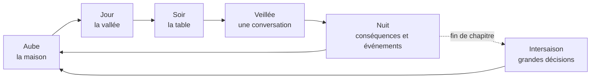
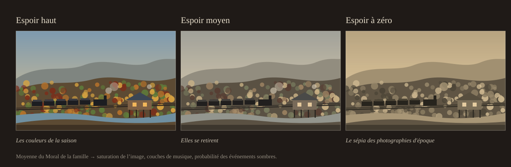
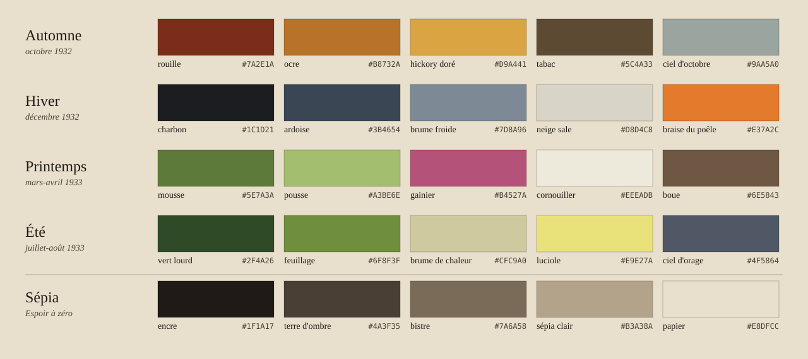

# As Long as We're Here
### *Tant qu'on est là* · Document de conception de jeu (GDD), v0.1

> « Huit bols sur la table. De quoi en remplir cinq. Tu as quatorze ans. »

---

## Sommaire

0. [Fiche signalétique](#0-fiche-signalétique)
1. [Le pitch](#1-le-pitch)
2. [Les quatre piliers](#2-les-quatre-piliers)
3. [Genre et point de vue : pourquoi ces choix](#3-genre-et-point-de-vue--pourquoi-ces-choix)
4. [Le cadre : Hollis, Kentucky, 1932-1933](#4-le-cadre--hollis-kentucky-1932-1933)
5. [La famille Caudill](#5-la-famille-caudill)
6. [Les mécaniques](#6-les-mécaniques)
7. [Structure de la partie et fins](#7-structure-de-la-partie-et-fins)
8. [Écriture et dialogues](#8-écriture-et-dialogues)
9. [Exemples d'événements](#9-exemples-dévénements)
10. [Direction artistique](#10-direction-artistique)
11. [Son et musique](#11-son-et-musique)
12. [Technique](#12-technique)
13. [Rigueur historique et représentation](#13-rigueur-historique-et-représentation)
14. [Production : prochaines étapes](#14-production--prochaines-étapes)
15. [Références](#15-références)
16. [Annexe : ordres de grandeur économiques (1932)](#annexe--ordres-de-grandeur-économiques-1932)

---

## 0. Fiche signalétique

| | |
|---|---|
| **Titre de travail** | *As Long as We're Here* (VF : *Tant qu'on est là*) |
| **Genre** | Survie narrative et gestion familiale, en personnage incarné |
| **Point de vue** | 2D de profil : la maison vue **en coupe** (comme une maison de poupée) et la vallée en défilement latéral |
| **On incarne** | Eli Caudill, 14 ans, troisième de cinq enfants |
| **Cadre** | Hollis, ville-compagnie fictive de l'est du Kentucky (Appalaches), d'octobre 1932 à septembre 1933 |
| **Durée** | 8 à 12 h par partie, rejouable (événements et issues variables) |
| **Plateformes** | PC (Steam) d'abord, puis Switch et consoles |
| **Moteur** | Godot 4 (.NET / C#) + Ink pour l'écriture |
| **Public** | Adolescents et adultes. PEGI 12 à 16 visé (faim, mort, travail des enfants, alcool ; aucune violence graphique) |
| **Comparables** | *This War of Mine* (dilemmes de survie), *Night in the Woods* (petite ville, vue de profil), *Gris* (la couleur comme émotion), *Valiant Hearts* (drame historique en 2D, archives à débloquer) |

---

## 1. Le pitch

**Été 1932.** L'usine Hollis Lumber & Stave, une scierie qui fabriquait aussi des douelles de tonneaux, ferme ses grilles. Amos Caudill y sciait depuis vingt ans, et ses deux fils aînés l'y avaient rejoint. Eli devait y entrer l'année suivante.

**Octobre.** Les dernières économies sont parties. La famille vit dans une maison qui appartient à la compagnie et achète à crédit au magasin de la compagnie, en bons de la compagnie. Il n'y a plus de compagnie, il ne reste que ses dettes.

**Le joueur incarne Eli.** Le jour, il parcourt la vallée pour rapporter quelque chose : du poisson, du charbon tombé des wagons, quelques cents gagnés à écorcer le tabac, une cruche de moonshine livrée pour le distillateur du coin. Le soir, il rentre et pose ce qu'il a trouvé sur la table. Il y a huit bols.

Au début, c'est Papa qui sert. Au fil des mois, à mesure que le père s'effondre, c'est vers Eli qu'on se tourne quand la marmite n'est pas assez pleine. Le jeu raconte comment on devient « l'homme de la maison » à quatorze ans, et ce que ça coûte.

---

## 2. Les quatre piliers

Chaque mécanique, chaque écran et chaque dialogue doit servir au moins un de ces piliers. Ce qui n'en sert aucun est coupé.

1. **Huit bouches, une marmite.** La pauvreté se joue d'abord à table. Toute décision est une décision de partage : qui mange, qui se chauffe, qui part.
2. **Grandir trop vite.** Le joueur gagne du pouvoir sur la famille exactement au rythme où le personnage perd son enfance. Son envie naturelle de tout contrôler et de tout optimiser devient le sujet du jeu.
3. **La dignité ou le pain.** Accepter la charité, voler, briser une grève, mentir à l'enquêtrice : survivre a un prix moral, et chaque membre de la famille ne le paie pas de la même façon.
4. **Rester ou partir.** *Qu'elle était verte ma vallée* contre *Les Raisins de la colère* : l'attachement à la terre et à la communauté face à la route. La partie se termine sur ce choix.

**Ton.** Réaliste et sobre, jamais misérabiliste. Il y a de la musique, des rires d'enfant, de l'entraide. C'est parce qu'on voit ce qu'il y a à perdre que la perte se ressent.

---

## 3. Genre et point de vue : pourquoi ces choix

### Le genre : survie narrative en personnage incarné

Dans *This War of Mine*, on dirige un groupe depuis l'extérieur. Ici, on **est** l'un des enfants de la famille, pas son gestionnaire. Le jeu superpose donc deux couches :

- **Le jour, l'aventure.** On contrôle directement Eli dans la vallée : exploration, petits boulots, glanage, infiltration légère.
- **Le soir, la gestion.** On rentre, on partage, on décide, mais seulement dans la limite de ce qu'un garçon de 14 ans a le droit de décider (voir [*Grandir trop vite*](#65-grandir-trop-vite--la-voix-et-lenfance-mécanique-signature)).

Ce mélange découle du sujet : la gestion n'est pas une interface neutre, c'est une place à table qu'on gagne et qu'on paie.

**Ce que le jeu n'est pas :** pas de combat, pas d'arbre de compétences, pas d'artisanat à grande échelle. Les activités ne sont pas des mini-jeux d'arcade mais des **gestes** : pêcher, ramasser, se cacher. Ils sont courts, lents, et résolus automatiquement une fois qu'on les a faits.

### Le point de vue : 2D de profil, maison en coupe

| Option | Verdict |
|---|---|
| **2D de profil, maison en coupe** ✅ | On voit les huit membres de la famille en même temps, dans leurs gestes quotidiens, et c'est le cœur émotionnel du jeu. Le cadrage frontal rappelle les photographies de l'époque. Les vallées encaissées de l'est du Kentucky se prêtent aux compositions verticales en plans successifs. La production 2D reste à la portée d'une petite équipe. |
| Isométrique | Excellent pour la gestion, mais place le joueur en position de « dieu » au-dessus de la famille, à l'opposé du pilier 2. |
| Première personne | Intime, mais on perd la vue d'ensemble de la famille et la lisibilité de son état. Coûteux en 3D. |
| Vue de dessus | Lisible mais froide : on perd les silhouettes, les postures et la verticalité des montagnes. |

La caméra se tient **à hauteur d'enfant** : les têtes des adultes sortent souvent du cadre, les comptoirs sont hauts et la casquette du contremaître touche le haut de l'écran.


---

## 4. Le cadre : Hollis, Kentucky, 1932-1933

### Hollis

- Ville-compagnie construite par la Hollis Lumber & Stave Co. dans une vallée étroite (un *holler*) au bord de Troublesome Creek, dans les monts Cumberland. Le ruisseau existe ; la ville et le comté sont fictifs.
- La compagnie possède tout : les maisons alignées sur pilotis contre la pente, le magasin, l'école à classe unique, l'église et les bons d'achat (le *scrip*) qui servaient de salaire. L'usine est fermée et les grilles sont enchaînées. Le magasin, lui, est resté ouvert, et le loyer court toujours.
- Petite ironie amère : l'usine taillait des douelles pour des tonneaux de whiskey que la Prohibition interdit de boire. Dans les collines, le moonshine, lui, se porte bien.
- À une heure de marche, la mine n° 4 de la Black Mountain Coal Co. tourne au ralenti. Elle embauche quand ses mineurs font grève.

### Les lieux de la vallée

On les trouve sur la carte qu'Eli dessine dans son cahier d'écolier ; un lieu y apparaît dès qu'il l'a découvert.

| Lieu | Ce qu'on y fait | Marche depuis la maison |
|---|---|---|
| **La maison** | Le centre du jeu : la table, la veillée, la nuit | — |
| **Le camp** | Les voisins, l'entraide, les vols, les rumeurs | 5 min |
| **Le bourg** | Magasin de la compagnie, école, église, bureau de poste, l'usine fermée, la maison du directeur sur la colline | 20 min |
| **Le ruisseau** | Pêche, lessive, baignade en été, baptêmes | 15 min |
| **La voie ferrée** | Charbon tombé des wagons, le train de 6 h 12, le campement des hobos, le « bull » (la police de la compagnie ferroviaire) | 30 min |
| **La montagne** | Chasse, collets, cueillette, ginseng, l'alambic de Dow Slone | 45 min |
| **La mine n° 4** | Embauche, grève, piquets | 1 h |
| **La vieille ferme** | Le domaine abandonné de Papaw, en haut du vallon, à restaurer pour la route « remonter » | 2 h |
| **Le chef-lieu** | Croix-Rouge, médecin, prêteur sur gages, banque fermée, gare | Une demi-journée (ou le camion du laitier) |

### Les gens de la vallée

| Personnage | Rôle |
|---|---|
| **Les Sizemore** | Voisins de palier : six enfants et une vache. Encore plus pauvres que les Caudill, et pourtant prêteurs de lait. |
| **Otis Hairston** | 14 ans, fils d'un mineur noir de la n° 4 venu d'Alabama. Il pêche avec Eli depuis toujours, ce que la vallée voit d'un mauvais œil. |
| **Mr. Pruitt** | Gérant du magasin de la compagnie, il tient l'ardoise. Ni bon ni méchant : il a des ordres. |
| **Miss Adair** | L'institutrice. Elle prête des livres, sert la soupe de midi et peut écrire une lettre de recommandation. |
| **Dow Slone** | Distillateur clandestin. Il paie bien et ne pose pas de questions. |
| **Frère Combs** | Prédicateur Old Regular Baptist. Réconfort, charité, et parfois jugement. |
| **L'infirmière à cheval** | Inspirée de la Frontier Nursing Service (Kentucky, fondée en 1925). Gratuite, mais elle a cinquante familles à voir. |
| **L'enquêtrice** | Envoyée par la Croix-Rouge pour vérifier que la famille « mérite » la farine. |
| **Le photographe** | Photographe de presse venu du Nord pour un reportage sur la misère des Appalaches. Il ouvre et ferme le jeu. |
| **Oncle Hiram** | Le frère de Papa, parti à Detroit. Il revient en plein hiver, les mains vides. |

### Le calendrier historique

| Date | Événement | Effet en jeu |
|---|---|---|
| Été 1932 | Fermeture de l'usine (prologue) | Tout commence |
| 8 nov. 1932 | Élection de Roosevelt | Débat à table. L'Espoir monte ou baisse selon Papa |
| 1932-1933 | La Croix-Rouge distribue la farine des surplus fédéraux de blé | Une aide sous conditions : l'enquêtrice |
| Hiver 1932-1933 | Le creux de la crise (un actif sur quatre au chômage en 1933) | Le chapitre le plus dur |
| 4 mars 1933 | Investiture : « la seule chose que nous devons craindre, c'est la peur elle-même », à la radio du magasin | Espoir en hausse |
| 6-13 mars 1933 | Fermeture des banques | Le scrip et le troc reprennent de la valeur |
| Avril 1933 | Civilian Conservation Corps : 30 $ par mois, dont 25 envoyés à la famille | Wes peut partir… s'il a 18 ans et si la famille est inscrite à l'assistance |
| 16 juin 1933 | NIRA, section 7(a) : droit syndical | Les organisateurs de l'UMWA arrivent : « Le Président veut que vous rejoigniez le syndicat ! » |
| Été 1933 | Grève et affrontements à la mine | L'arc de Clay |
| 5 déc. 1933 | Fin de la Prohibition | Après la fin du jeu : le moonshine rapporte jusqu'au bout |

---

## 5. La famille Caudill

Huit personnes, huit bols. Chacun a un **trait** qui modifie ses réactions dans la simulation, des **tâches** qu'il peut accomplir et un **arc** possible, qui n'est jamais garanti.

| | Âge | Trait (effet en jeu) | Tâches | Ce qui peut lui arriver |
|---|---|---|---|---|
| **Amos** (Papa) | 48 | **Fier** : la charité lui coûte du Moral, et il refuse de signer pour l'assistance | Chercher du travail, couper du bois, réparer | S'effondrer (silence, boisson), partir au Nord, rejoindre le syndicat, se relever |
| **Ida** (M'man) | 43 | **Pilier** : elle se prive en secret quand la marmite manque | Lessive pour le bourg, conserves, couture | Tomber malade d'épuisement, devenir l'alliée d'Eli |
| **Mamaw Dell** | 76 | **Enracinée** : elle refusera de quitter la montagne. **Guérisseuse** : remèdes de plantes | Remèdes, histoires (Espoir), garder Pearl, apprendre le ginseng à Eli | Refuser de manger pour les petits, « remonter » seule à la vieille ferme |
| **Clay** | 20 | **Colérique** | Mine, travaux de force | Briseur de grève ou syndicaliste, partir en train de marchandises, prison |
| **Wes** | 17 | **Musicien** : son violon soutient l'Espoir de toute la maison | Bois, petits boulots | Le CCC (en mentant sur son âge), vendre son violon |
| **Eli** | 14 | Le joueur | Tout ce qui se fait dans la vallée | Grandir |
| **Ruth** | 11 | **Studieuse** : l'école est son espoir | Garder Pearl, couture, école | Partir chez une tante à Lexington, obtenir une bourse pour une école de mission (inspirée de la Hindman Settlement School, Knott County) |
| **Pearl** | 4 | **Fragile** : a besoin de lait, tombe malade vite | Rire (fait monter l'Espoir) | Fièvre, pellagre. En plein hiver, le comté propose l'orphelinat |

**Silhouettes** (chaque membre doit se reconnaître en ombre chinoise) : Papa, grand et voûté sous un chapeau mou. M'man, tablier et châle. Mamaw, petite, bonnet et pipe en épi de maïs. Clay, casquette et manches retroussées. Wes, long et maigre, le violon sous le bras. Eli, dans une salopette trop grande héritée de Wes. Ruth, des nattes et un livre. Pearl, une robe taillée dans un sac de farine imprimé.

---

## 6. Les mécaniques

Cinq mécaniques principales et deux systèmes transversaux, chacun relié à un pilier.

| | Mécanique | Pilier |
|---|---|---|
| 6.1 | **La Table** : partager la marmite | Huit bouches |
| 6.2 | **La Journée** : la lumière comme ressource | Huit bouches, grandir |
| 6.3 | **La Maison** : huit vies sous un toit | Huit bouches, dignité |
| 6.4 | **L'Ardoise** : dette, loyer et objets de famille | Dignité, rester ou partir |
| 6.5 | **Grandir trop vite** : la Voix et l'Enfance *(signature)* | Grandir |
| 6.6 | *L'Espoir* : la vallée qui perd ses couleurs | Tous |
| 6.7 | *L'Entraide* : la mémoire du camp | Dignité, rester |

### 6.0 La boucle de jeu



| Phase | Durée | Ce qui s'y passe |
|---|---|---|
| **Aube** | ~1 min | On voit l'état de la maison d'un coup d'œil. Eli choisit ce qu'il emporte (sac, ligne, lance-pierre, la carabine .22 de Papa si on la lui confie). |
| **Jour** | 8 à 12 min | Exploration libre de la vallée. La lumière du jour est la ressource principale. |
| **Soir : la Table** | 2 à 3 min | Ce qu'Eli rapporte est posé sur la table, chacun raconte sa journée, et on partage. |
| **Veillée** | 1 à 2 min | Une seule conversation par soir, avec la personne de son choix. |
| **Nuit** | Résolution | Faim, froid, maladie, puis les événements (on frappe à la porte…). |

### 6.1 La Table : partager la marmite

**Principe.** Tout ce qu'on cuisine forme la marmite, mesurée en **bols**. Chaque soir, il faut remplir huit bols.

**Règles**
- Chaque membre a besoin d'**un bol par jour**. Pearl, d'un demi. Un adulte qui a fait un travail de force, d'un et demi.
- Le joueur verse les louches dans les bols en les faisant glisser. Un bol vide reste posé sur la table, et il se voit.
- La **Faim** de chacun suit cinq crans : *Rassasié → Faim → Affamé → Épuisé → Mourant*. Un bol plein la fait descendre d'un cran, un demi-bol la laisse stable, un bol vide la fait monter d'un cran.
- **La variété et la pellagre.** Chaque aliment porte une étiquette : *Grain*, *Gras*, *Haricots*, *Verdure*, *Viande et poisson*, *Lait et œufs*. Quelqu'un qui ne mange que du Grain et du Gras pendant plus de six jours accumule un risque de pellagre : fatigue, peau brûlée, confusion. C'était une vraie maladie des régimes à base de maïs dans le Sud des années 1930. La levure de bière, le lait, la viande et la verdure la font reculer. Rapporter de l'argent pour acheter du maïs ne suffit donc pas : il faut aussi pêcher, chasser et cueillir.
- **Ce qu'on ne dit pas.** Quand la marmite est trop petite, Ida se prive en secret (« je me servirai après »), et Mamaw refuse son bol « pour la petite ». Le jeu ne l'affiche nulle part. Il faut le remarquer : une silhouette qui maigrit, une remarque de Ruth, une question posée à la veillée. Une fois qu'il l'a découvert, Eli peut agir, si sa Voix le lui permet.
- **Qui sert ?** Selon la Voix d'Eli (6.5), c'est Papa, M'man ou Eli qui remplit les bols. Tant que ce n'est pas lui, Eli ne contrôle que son propre bol, mais il peut toujours le partager.

**Ce que ça fait ressentir :** compter. Chaque soir, le joueur compte les bols à voix basse, comme Ida.

### 6.2 La Journée : la lumière comme ressource

**Principe.** Eli a une journée de lumière à dépenser. Chaque trajet et chaque activité en consomme.

**Règles**
- **La durée du jour suit les saisons** : environ 9 h 30 de lumière en décembre et 14 h 30 en juin, calculées pour la latitude de l'est du Kentucky. L'hiver cumule tout : moins d'heures, plus de froid, plus de besoins.
- **Ce qu'Eli mange compte.** S'il s'est couché affamé, il perd des heures utiles le lendemain (1 h s'il a faim, 2 h s'il est affamé, 4 h s'il est épuisé), et les gestes deviennent plus difficiles. Donner son bol à Pearl, c'est raccourcir sa propre journée.
- **Rentrer après la nuit tombée** reste possible, mais M'man s'inquiète (son Moral baisse), et la nuit, la montagne et la voie ferrée sont dangereuses.
- **L'école**, du lundi au vendredi, prend toute la matinée. Elle apporte une soupe à midi, qui n'est pas prise sur la marmite (inspirée des cantines organisées par les Quakers dans les bassins houillers en 1931-1932). Elle fait aussi monter l'Enfance et l'Instruction et donne accès à Miss Adair. Sécher l'école libère des heures, mais un jour, l'institutrice vient frapper à la porte.

**Les activités**

| Catégorie | Exemples | Rapporte | Risque | Coût en Enfance |
|---|---|---|---|---|
| **Glaner** | Pêcher, cueillir (noix, mûres, ail des bois, *poke sallet*), ramasser le charbon tombé le long des voies, le bois mort, poser des collets | Nourriture, combustible | Faible | Aucun |
| **Petits boulots** | Écorcer le tabac, cirer des chaussures, porter l'eau, livrer pour le magasin, déterrer et vendre le ginseng | Des cents, du troc | Faible | Léger |
| **Zone grise** | Grimper sur les wagons pour faire tomber le charbon, livrer le moonshine de Dow Slone, braconner sur les terres de la compagnie | Beaucoup | Arrestation, coups, blessure | Moyen |
| **Voler** | Jardins, poulaillers, magasin de la compagnie, réserve de charbon du directeur | Beaucoup | Réputation, prison, honte | Fort |
| **Demander** | La file de la Croix-Rouge, l'église, les voisins | Nourriture | Le Moral des membres fiers | Variable |

**Les gestes** (chacun dure moins de deux minutes et se résout automatiquement, avec un rendement moyen, une fois qu'on l'a fait une première fois) :
- **Pêcher** : lire le courant, attendre. Un geste de patience.
- **Le charbon des wagons** : le train ralentit dans la côte. Il faut grimper au bon moment, faire tomber les blocs et sauter avant le pont, pendant que le bull fait sa ronde (infiltration légère, champs de vision).
- **Le ginseng** : observer le sous-bois et repérer les feuilles à cinq folioles et les baies rouges d'automne. Mamaw apprend à Eli à les reconnaître.
- **Le moonshine** : choisir un itinéraire dans la montagne pour éviter l'agent fédéral et l'adjoint du shérif. Une cruche cassée, c'est une dette envers Dow.
- **Le magasin** : marchander, troquer, demander du crédit, en dialogue.

### 6.3 La Maison : huit vies sous un toit

**Trois états par personne** : la **Faim**, la **Santé** (*Bien portant → Malade → Gravement malade → Mourant*, plus des affections : rhume, pneumonie, pellagre, dysenterie, blessure) et le **Moral** (*Serein → Triste → Abattu → Brisé*).

**Une lecture diégétique.** On ne lit pas des chiffres, on regarde la maison : les silhouettes maigrissent (trois stades par personnage), les postures s'affaissent, on entend une toux dans la nuit, et un jour Papa ne rentre plus du perron. Le cahier d'Eli donne la version écrite de tout cela pour qui en a besoin (accessibilité).

**Les tâches.** Chaque soir, dans la limite de la Voix d'Eli, on décide de ce que chacun fera le lendemain : chercher du travail, couper du bois, faire la lessive pour le bourg, garder Pearl, aller à l'école, s'occuper du potager (au printemps), préparer des remèdes, se reposer.

**L'autonomie.** Un membre au Moral bas peut refuser une tâche, ou agir de lui-même : Clay file à la réunion syndicale, Papa boit les derniers cents.

**La veillée.** Une seule conversation par soir. C'est là qu'on découvre ce qu'on ne dit pas, qu'on console (le Moral remonte) et qu'on gagne la confiance de chacun.

**Le froid.** La maison consomme chaque jour du combustible selon la température. Quand il manque, on brûle les meubles : les chaises disparaissent et on s'assoit sur des caisses. Ensuite viennent les maladies.

**Les soins**

| Option | Coût | Efficacité |
|---|---|---|
| Les remèdes de Mamaw | Gratuits | Incertaine |
| L'infirmière à cheval | Gratuite | Bonne, mais elle passe dans 2 ou 3 jours |
| Le médecin du chef-lieu | 2 $ comptant et une demi-journée de marche | Bonne, et immédiate |
| La levure de bière (contre la pellagre) | Quelques cents, ou la Croix-Rouge | Bonne |

**Les départs.** On peut perdre quelqu'un sans qu'il meure : Clay saute dans un train de marchandises, Wes part au CCC, Ruth est envoyée chez une tante, Pearl à l'orphelinat du comté, Papa au Nord, Mamaw remonte à la vieille ferme. Chaque départ soulage la marmite et laisse une place vide à table. Ceux qui sont partis peuvent écrire (un mandat, des nouvelles)… ou se taire.

**La mort.** Elle existe, mais n'arrive jamais hors champ. Une maladie mortelle se voit venir pendant plusieurs jours, et la mort survient toujours au cours d'une journée jouée. Puis la partie continue.

### 6.4 L'Ardoise : dette, loyer et objets de famille

**Principe.** La dette est l'horloge du jeu. Elle avance même quand on ne fait rien.

- **Le loyer.** La maison appartient à la compagnie : 8 $ par mois, dus le 1er.
- **L'ardoise du magasin.** On peut acheter à crédit au magasin de la compagnie, à des prix 30 % plus chers qu'à l'épicerie du chef-lieu. Mais l'épicerie est loin et ne fait pas crédit. Le loyer impayé s'ajoute à l'ardoise.
- **Les seuils.** Au-delà de 25 $, Mr. Pruitt coupe le crédit. Au-delà de 40 $ arrive un avis d'expulsion, puis la visite de l'adjoint du shérif, puis l'expulsion : les meubles sur la route, image emblématique de l'époque.
- **L'expulsion n'est pas un *game over*.** Elle force le départ, vers la vieille ferme ou le campement de tentes au bord de la voie, dans les pires conditions.
- **Le scrip** ne vaut rien hors du magasin de la compagnie. Ailleurs, on l'échange à 70 % de sa valeur, quand on trouve preneur.
- **Le troc** (œufs, ginseng, charbon, moonshine, travail) est l'économie réelle de la vallée.

**Les objets de famille.** Chacun a un usage ou soutient le Moral de quelqu'un. Les vendre au prêteur sur gages rapporte de l'argent, et laisse un vide visible dans la maison : une marque plus claire sur le mur, là où pendait le violon.

| Objet | Ce qu'il apporte | Qui en souffre s'il est vendu |
|---|---|---|
| La montre de Papa | — | Papa (beaucoup) |
| Le violon de Wes | Soirées de musique (Espoir) | Wes, et toute la maison se tait |
| L'alliance d'Ida | — | Ida, en silence |
| Le quilt de Mamaw | De la chaleur l'hiver | Mamaw |
| La carabine .22 | La chasse | Personne, mais plus de viande |
| La Bible familiale | Les naissances y sont inscrites | Invendable : personne ne l'achèterait |

### 6.5 Grandir trop vite : la Voix et l'Enfance (mécanique signature)

Deux valeurs propres à Eli, qui tirent en sens contraire.

#### La Voix : sa place à table, au sens propre

Le siège d'Eli se rapproche de celui de Papa à mesure que sa Voix grandit.

| Niveau | Nom | Ce qu'Eli contrôle |
|---|---|---|
| 0 | *Le gamin* | Son propre bol et ce qu'il rapporte. Papa sert, Papa décide. |
| 1 | *On t'écoute* | Une proposition par soir (« Donne ma part à Pearl », « Clay devrait aller à la mine »), acceptée ou non selon l'humeur des parents et ce qu'Eli a rapporté. |
| 2 | *Ton avis compte* | Il partage la marmite avec M'man, assigne les tâches de Ruth et de Pearl, propose celles des grands. |
| 3 | *L'homme de la maison* | Tout : partage, tâches, ventes, grandes décisions. Le siège de Papa. |

La Voix monte avec ce qu'Eli rapporte (et que la famille voit), avec les bonnes décisions et avec l'arc du père (le jour où Papa ne se lève plus, le jour où il part). Elle peut aussi redescendre, si Papa se relève ou revient.

**Effet de bord voulu : la progression sert de tutoriel.** Au début, le joueur n'a que la vallée à apprendre. La gestion familiale s'ouvre à lui au moment où l'histoire la lui impose.

#### L'Enfance : ce qui reste de ses quatorze ans

- **Elle baisse** quand Eli sèche l'école, fait un travail d'homme, vole, voit ou commet des violences, se couche affamé, et à chaque niveau de Voix gagné.
- **Elle remonte lentement** quand il joue avec Pearl, se baigne, va à l'école, lit, écoute Wes jouer ou pêche avec Otis.
- **Elle ne revient jamais entièrement :** elle ne peut pas remonter au-dessus de son niveau du début du chapitre.

**Ses effets en jeu**
- **Enfance haute :** Eli a accès aux *moments d'enfant* (une partie de billes avec Ruth, une chanson apprise à Pearl, un concours de ricochets). Ils prennent du temps, mais font remonter le Moral de toute la famille. Les rires d'enfant sont une ressource.
- **Enfance basse :** ces options s'éteignent dans l'interface : « Tu n'en as plus envie. » En contrepartie, Eli est **endurci** : voler ou mentir ne lui coûte plus de Moral, les adultes le prennent au sérieux (meilleures négociations) et il a accès aux travaux d'homme (la mine, le piquet de grève).

**On ne peut pas avoir les deux.** Le joueur qui veut tout contrôler et tout optimiser fabrique, mécaniquement, un enfant qui n'en est plus un. Le joueur qui protège l'enfance d'Eli laisse M'man décider, avec prudence, et parfois mal.

### 6.6 L'Espoir : la vallée qui perd ses couleurs

- L'**Espoir** est la moyenne du Moral de la famille, et c'est la valeur la plus visible du jeu : **il règle la saturation de l'image**. Espoir haut : les rouilles et les ocres de l'automne appalachien, le vert tendre du printemps. Espoir bas : la vallée glisse vers le sépia des photographies d'époque. *Qu'elle était verte ma vallée*, au sens littéral.
- Il règle aussi **la musique** : les couches instrumentales disparaissent une à une (le banjo, puis le violon, jusqu'à ce qu'il ne reste qu'une voix), ainsi que la probabilité de certains événements (boisson, disputes, départs).
- **Ce qui le nourrit :** les soirées de musique (si le violon n'est pas vendu), le culte du dimanche, les lettres de ceux qui sont partis, un repas complet, un anniversaire, la radio du magasin le 4 mars 1933, les premières verdures du printemps, les moments d'enfant.
- **Accessibilité :** l'information n'est jamais portée par la seule couleur. Postures, musique et cahier la redoublent.



### 6.7 L'Entraide : la mémoire du camp

> Si t'as des ennuis, va voir les pauvres gens : y a qu'eux qui t'aideront.
> — d'après Ma Joad, *Les Raisins de la colère*

- Chaque foyer du camp garde une **mémoire des services** : ce que les Caudill lui ont donné, et ce qu'ils lui ont pris.
- **Donner quand on n'a presque rien** coûte cher tout de suite et rapporte plus tard, au moment où on en a le plus besoin : les Sizemore apportent du lait pendant la fièvre de Pearl, les voisins se massent devant la maison le jour où l'adjoint vient expulser, les hobos préviennent Eli que le bull a changé d'horaire.
- **La trahison laisse des traces** : briser la grève, dénoncer un voleur, voler un voisin.

---

## 7. Structure de la partie et fins

### Les chapitres

| | Période | Jours joués | Ce qui pèse | Moments forts |
|---|---|---|---|---|
| **Prologue** | Août 1932 | 1 | — | Eli porte les gamelles à l'usine, le dernier coup de sifflet, les chaînes sur les grilles |
| **I. Les noix et le ginseng** | Octobre 1932 | ~12 | L'argent, la dette | Le photographe et la photo de famille, la fin de la saison du ginseng, le beurre de pommes qu'on touille toute la nuit chez les Sizemore, le premier refus de Papa |
| *Intersaison* | Novembre | — | — | L'élection. Papa part-il chercher du travail au Nord ? |
| **II. Le charbon des voies** | Décembre 1932 | ~12 | Le froid, la faim, la maladie | Les jours les plus courts de l'année, un Noël sans oranges, l'enquêtrice, le retour d'Oncle Hiram |
| *Intersaison* | Janvier-février | — | — | Le creux de l'hiver |
| **III. La verdure** | Mars-avril 1933 | ~12 | La dignité, les premiers choix | Le 4 mars à la radio, la fermeture des banques, les premières verdures, le CCC, la crue de printemps |
| *Intersaison* | Mai-juin | — | — | La NIRA. Les organisateurs syndicaux arrivent |
| **IV. Les lucioles** | Juillet-août 1933 | ~12 | Le conflit, le choix final | La grève de la n° 4, le *revival* sous la tente, l'eau du ruisseau, la décision : rester, remonter ou partir |
| **Épilogue** | Septembre 1933 | — | — | La deuxième photo |

### Le temps

- Une journée jouée dure de 10 à 15 minutes.
- Entre deux journées jouées, 0 à 2 jours « ordinaires » peuvent passer. Ils sont résolus par la **routine** : les dernières tâches assignées et le niveau de rationnement (*plein*, *serré* ou *maigre*).
- Entre deux chapitres, une **intersaison** : un montage narré (photographies, voix du vieil Eli) résout plusieurs semaines à partir de deux ou trois grandes décisions familiales. Par exemple : « Papa part-il au Nord ? », « Vend-on le violon pour passer janvier ? », « Rationnement serré ou maigre ? »
- **Règle : personne ne meurt pendant une intersaison.** Elle peut aggraver un état, mais la conséquence se joue toujours au chapitre suivant.

### Les trois routes

Toute l'année, le joueur prépare (ou subit) l'une de ces trois issues :

- **Rester à Hollis.** Garder la maison (l'ardoise sous contrôle) et trouver un revenu : la mine sous contrat syndical, l'assistance, le mandat du CCC. *Qu'elle était verte ma vallée* : la communauté, la mine, la mémoire.
- **Remonter à la vieille ferme.** Restaurer le domaine de Papaw, à deux heures de marche en haut du vallon : le toit, la clôture, les semences, le potager, peut-être une vache. C'est un chantier long, qui vole des journées à la survie immédiate. L'autarcie, l'isolement, la terre. Mamaw ne veut que ça.
- **Partir vers le Nord.** Detroit, Akron ou Dayton. Il faut de l'argent pour le voyage (ou les trains de marchandises), une adresse, et accepter que Mamaw ne viendra pas. Oncle Hiram, revenu de Detroit les mains vides, rappelle que la route ne promet rien. *Les Raisins de la colère*.

### La photo finale

**Au chapitre I**, le photographe de presse veut photographier la famille pour son reportage. Papa refuse d'être « montré comme un pauvre ». Ida accepte, à condition qu'on lui envoie un tirage. Ce sera la seule photo des huit.

**À l'épilogue**, il revient en septembre 1933 et reprend le même cadrage. Le jeu se termine sur cette deuxième photo, composée par la simulation :
- **Le lieu** : le perron de Hollis, la vieille ferme ou un trottoir de Detroit.
- **Les présents** : ceux qui sont encore là. Les absents vivants sont représentés par une lettre dans la main d'Ida ; les morts, par une place que personne n'a comblée.
- **Eli** : au milieu des enfants (Enfance préservée), ou debout à côté d'Ida, là où se tenait Papa (Voix 3).
- Puis le vieil Eli dit, en quelques lignes, ce que chacun est devenu.

**Trois exemples de fins**
- **Le perron de Hollis.** Sept sur la photo, Mamaw est morte en février. Eli se tient à côté d'Ida ; la lettre de Papa, partie de Detroit, est dans sa main. *« J'ai pris la place de mon père à la n° 4 en 1934. J'y suis resté trente et un ans. Ruth, elle, est devenue institutrice. »*
- **La vieille ferme.** Huit sur la photo, Eli pieds nus au milieu des petits. *« On a eu faim encore longtemps. Mais on a eu faim ensemble. »*
- **Un trottoir de Detroit.** Cinq sur la photo : Mamaw est restée sur sa montagne, Clay est en prison à Harlan, Pearl repose au cimetière de Hollis. *« Je n'ai jamais revu la vallée verte. Je ne suis pas sûr qu'elle l'ait jamais été. »*

**Philosophie de difficulté : la partie ne se gagne pas, elle se traverse.** La fin parfaite (huit sur la photo, Eli encore un enfant) existe, mais elle doit rester rare. Un **mode récit**, moins exigeant, est proposé à ceux qui viennent surtout pour l'histoire.

---

## 8. Écriture et dialogues

- **Peu de texte, beaucoup de gestes.** Des dialogues courts et secs, avec un humour pudique. Personne ne fait de discours sur la crise : on parle de bols, de charbon et de chaussures.
- **Un narrateur : le vieil Eli**, des décennies plus tard, comme dans *Qu'elle était verte ma vallée*. Il n'intervient qu'à l'ouverture des chapitres, pendant les intersaisons et à la fin.
- **Le registre** : un français oral et rural, sans caricature (« Pap' », « M'man », « Mamaw »). Pas de patois inventé, pas d'orthographe phonétique. En anglais, le parler appalachien sera documenté et relu par des locuteurs.
- **Les choix de dialogue ont des conséquences mécaniques** (Voix, Moral, Entraide), suggérées par le ton plutôt que par des icônes.

### Extraits

**Ouverture du chapitre I (le vieil Eli)**
> On était huit, cet automne-là. Je le sais parce que M'man comptait les bols tous les soirs, à voix basse, comme on compte ses enfants sur un quai de gare. Huit. Elle disait : tant qu'on est là, tous les huit, il peut rien nous arriver.
> Elle se trompait, bien sûr. Mais pas sur tout.

**La première table (Voix 0 : Papa sert)**
> *Papa remplit les bols. Arrivé au sien, il n'y verse qu'une demi-louche.*
> **RUTH** — T'en as presque pas, Pap'.
> **PAPA** — J'ai pas travaillé aujourd'hui. Un homme qui travaille pas a pas besoin de manger comme un homme qui travaille.
> *Personne ne répond. Clay repose sa cuillère.*
>
> → *Donner la moitié de ton bol à Pearl* · *Manger* · « Moi non plus, j'ai pas travaillé. »

**La veillée avec M'man**
> **ELI** — M'man, t'as mangé ?
> **IDA** — J'ai goûté en cuisinant. Va te coucher, t'as l'école demain.
>
> *(Si Eli l'a observée pendant le repas)* → « Je t'ai regardée. T'as rien goûté du tout. »
> **IDA** — … Les petits d'abord, Eli. Ça a toujours été comme ça.
> *(Eli peut désormais réserver le bol de M'man, s'il a la Voix pour le faire.)*

**Clay et Papa**
> **CLAY** — La Black Mountain embauche. Un dollar cinquante la journée, payé comptant.
> **PAPA** — Elle embauche parce que les hommes de la n° 4 sont en grève. Tu prendras pas le pain d'un homme qui se bat pour le sien.
> **CLAY** — Et ce pain-là, Pap', il est où ? Dans le bol de Pearl ?
>
> → *Soutenir Clay* · *Soutenir Papa* · *Se taire*

**Wes et le CCC**
> **WES** — Trente dollars par mois, Eli. Vingt-cinq qu'ils envoient direct à M'man. Faut juste avoir dix-huit ans… et que Pap' signe les papiers de l'assistance.
> **ELI** — T'as dix-sept ans.
> **WES** — J'en aurai dix-huit le jour où je l'écrirai.

**Oncle Hiram, revenu de Detroit**
> **HIRAM** — Ford a fermé la moitié de son usine. Là-haut, les gens font la queue pour la soupe en costume-cravate. Y a rien là-bas, Amos. Rien que du froid qui coûte plus cher qu'ici.

---

## 9. Exemples d'événements

Les événements sont écrits en données (conditions, poids, effets) et en Ink (texte). En voici six, pour donner le ton.

**L'orange de Noël** *(hiver)*
Chaque année, la compagnie offrait une orange et un sachet de bonbons à chaque enfant du camp. Pas cette année. Pearl a quatre ans, et elle s'en souvient quand même.
- Échanger le couteau d'Eli au magasin contre une orange : Enfance en baisse, Pearl et l'Espoir en hausse.
- Voler une orange dans la caisse livrée chez le directeur : risqué, Enfance en baisse, l'Espoir monte fortement si ça marche.
- Sculpter un jouet en bois : deux heures de lumière en moins le 24 décembre, Enfance et Espoir en hausse.
- Ne rien faire. Pearl ne demande rien, et c'est pire.

**L'enquêtrice** *(hiver)*
Avant de distribuer la farine, la Croix-Rouge envoie une enquêtrice. Le violon de Wes est accroché au mur et la montre de Papa posée sur la cheminée. « Vous avez des biens à vendre, madame Caudill. »
- Cacher le violon et la montre avant sa visite (possible si les voisins ont prévenu Eli) : farine obtenue, mais le mensonge coûte à Papa.
- Les vendre d'abord : de l'argent, moins d'Espoir.
- Montrer la maison telle qu'elle est : la farine peut être refusée, mais Papa garde sa fierté.
- Papa refuse de la laisser entrer : pas de farine.

**Le train de 6 h 12** *(hiver)*
Le train de charbon ralentit dans la côte de Lick Branch. Il y a un nouveau bull, et on dit qu'il cogne.
- Grimper sur le wagon (geste d'infiltration) : trois jours de charbon. Si Eli est pris : des coups, la Santé et l'Enfance baissent.
- Ramasser le long des voies : une demi-journée de charbon, sans risque.
- Demander aux hobos l'horaire de ronde du bull (si l'Entraide le permet).

**La fièvre de Pearl** *(toute saison)*
Pearl brûle depuis la nuit.
- Le médecin du chef-lieu : 2 $ comptant et une demi-journée de marche (le laitier peut emmener Eli contre un service).
- L'infirmière à cheval : gratuite, elle passera « dans deux ou trois jours ».
- Le remède de Mamaw (tisane d'eupatoire perfoliée, cataplasme d'oignon) : gratuit, résultat incertain.
- Prier au culte avec M'man : l'Espoir monte, rien de plus.

**Les poules** *(automne)*
Deux poules ont disparu. Au matin, Eli trouve des plumes devant la porte des Sizemore, dont les six enfants n'ont pas mangé depuis deux jours.
- Aller réclamer : l'Entraide avec les Sizemore s'effondre, une poule peut-être récupérée.
- Le dire à Papa : il ira, et ça finira mal.
- Ne rien dire : les Sizemore savent que tu sais.
- Leur apporter les œufs de la dernière poule : l'Entraide monte fortement, la marmite baisse.

**Un dollar cinquante la journée** *(été)*
La n° 4 est en grève. La Black Mountain embauche des remplaçants, payés comptant et pas en scrip. Clay tient le piquet de grève.
- Wes y va : beaucoup d'argent, mais le camp ne pardonne pas, et Clay et Wes ne se parlent plus.
- Eli y va. Il a 14 ans, c'est interdit, mais pendant une grève personne ne vérifie : de l'argent, l'Enfance s'effondre, c'est dangereux.
- Personne n'y va : le Moral de Clay monte, la marmite attend.
- Eli porte à manger au piquet : l'Entraide monte, et la confiance de Clay aussi.

---

## 10. Direction artistique

### Intention : « une photographie de 1932 qui se souvient d'avoir été en couleurs »

- **Technique** : 2D peinte (gouache et fusain), texture de papier, grain photographique léger, vignettage. Les personnages sont animés en 2D squelettique (découpage) avec des visages simples : l'émotion passe par la posture.
- **La couleur, c'est l'Espoir** (voir 6.6). Chaque saison a sa palette, et toutes tendent vers le même sépia.
- **La lumière** : les nuits d'hiver, la seule couleur chaude de l'écran est la lueur du poêle et de la lampe à pétrole. Le foyer, au sens propre.
- **La maison s'use.** Les objets vendus laissent leur marque sur le mur, les chaises brûlées sont remplacées par des caisses, les vêtements se couvrent de pièces au fil des mois. Les robes sont taillées dans des sacs de farine imprimés, comme à l'époque, où les minoteries imprimaient leurs sacs de motifs pour cette raison.
- **Les personnages** doivent être reconnaissables en ombre chinoise : on doit identifier chaque membre de la famille en noir pur. Chacun a trois stades de maigreur.
- **La représentation** : jamais de caricature « hillbilly » (pieds nus comiques, cruche marquée XXX, dents manquantes pour faire rire). Les Appalaches ont assez été moquées. On montre ces gens comme Walker Evans les photographiait : de face, avec respect.

### Palettes



| Palette | Teintes |
|---|---|
| **Automne** | rouille `#7A2E1A` · ocre `#B8732A` · hickory doré `#D9A441` · tabac `#5C4A33` · ciel d'octobre `#9AA5A0` |
| **Hiver** | charbon `#1C1D21` · ardoise `#3B4654` · brume froide `#7D8A96` · neige sale `#D8D4C8` · braise du poêle `#E37A2C` |
| **Printemps** | mousse `#5E7A3A` · pousse `#A3BE6E` · gainier `#B4527A` · cornouiller `#EEEADB` · boue `#6E5843` |
| **Été** | vert lourd `#2F4A26` · feuillage `#6F8F3F` · brume de chaleur `#CFC9A0` · luciole `#E9E27A` · ciel d'orage `#4F5864` |
| **Sépia (Espoir à zéro)** | encre `#1F1A17` · terre d'ombre `#4A3F35` · bistre `#7A6A58` · sépia clair `#B3A38A` · papier `#E8DFCC` |

### Une interface diégétique

- **Le cahier d'écolier d'Eli** sert de menu, de journal et de carte : des plans dessinés au crayon, des listes rayées, les dates.
- **Les ressources se voient dans la maison** : l'étagère du garde-manger (bocaux, sacs), le tas de bois et le seau à charbon, la boîte à café où dort l'argent, l'ardoise tenue par Mr. Pruitt.
- **Les typographies** : du crayon pour le cahier, de la machine à écrire pour les courriers officiels (avis d'expulsion, lettre du CCC), les lettrages des affiches et des journaux de 1932 pour les titres.

---

## 11. Son et musique

- **La musique traditionnelle des Appalaches** : banjo *clawhammer*, violon, dulcimer des Appalaches, chant a cappella. On puise dans le répertoire traditionnel du domaine public (les ballades anglo-écossaises conservées dans les montagnes, *Barbara Allen*, *Wayfaring Stranger*, *Shady Grove*, *Man of Constant Sorrow*), complété par des compositions originales.
- **Une musique dynamique** réglée par l'Espoir (voir 6.6).
- **La musique dans le monde du jeu** : Wes au violon (s'il le vend, la maison se tait), Mamaw qui chante en cousant, les cantiques « lignés » des Old Regular Baptists à l'église (le prédicateur dit la ligne, l'assemblée la reprend lentement), les chants syndicaux à la mine. *Which Side Are You On?* a été écrite en 1931 dans le comté de Harlan ; ses droits sont à vérifier, et on écrira une chanson originale si nécessaire.
- **Le son du silence.** Pendant vingt ans, le sifflet de l'usine a rythmé la vallée. Le premier matin du chapitre I, à l'heure où il sonnait, on n'entend rien. Le joueur ne le remarque peut-être pas. Papa, si : il est debout sur le perron, à l'heure.
- **Les ambiances** : le ruisseau, les trains de charbon, l'engoulevent bois-pourri la nuit, la toux dans la chambre d'à côté, le poêle qui craque.

---

## 12. Technique

### Choix

| Besoin | Choix | Pourquoi |
|---|---|---|
| Moteur | **Godot 4 (.NET)** | 2D natif, léger, open source, sans redevance |
| Langage | **C#** | La simulation est une bibliothèque testable |
| Narration | **Ink** (inkle), via le module GodotInk | Langage narratif éprouvé (*80 Days*, *Heaven's Vault*) ; les scripts lisent et modifient l'état de la simulation |
| Animation | Squelettes 2D (Skeleton2D ou Spine) | Trois stades de maigreur par personnage sans tout redessiner |

### Architecture

```
Simulation/    Bibliothèque C# pure, sans dépendance à Godot : famille, membres,
               marmite, ardoise, calendrier, événements. Déterministe (graine
               aléatoire) et couverte par des tests unitaires.
Presentation/  Scènes Godot, animation, shaders, interface. Lit l'état de la
               simulation et lui envoie des commandes, sans jamais la modifier
               directement.
Content/       Événements en données (conditions, poids, effets), textes Ink,
               tables d'équilibrage (CSV/JSON) modifiables sans programmer.
```

### Points techniques notables

- **Équilibrer par la simulation.** La simulation tourne sans affichage. On joue 10 000 années avec des stratégies automatiques (« l'égoïste », « le saint », « le voleur », « l'écolier ») pour vérifier qu'aucune ne domine et que la fin parfaite reste rare sans être impossible. Ces tests tournent en intégration continue.
- **Le shader de l'Espoir.** Un post-traitement plein écran mélange la table de couleurs (LUT) de la saison et la LUT sépia selon l'Espoir, puis ajoute le grain de papier et le vignettage. Les transitions sont lentes : jamais de saut visible d'un soir à l'autre.
- **La lumière du jour.** Les heures de lever et de coucher du soleil sont calculées pour 37,3° N (est du Kentucky) à chaque date du calendrier.
- **La sauvegarde.** Automatique chaque soir, une seule par partie : les choix sont définitifs, comme dans *This War of Mine*. Le mode récit permet de recommencer une journée.
- **La localisation** en français et en anglais dès le premier jour (Ink et tables de chaînes).

---

## 13. Rigueur historique et représentation

- **Les Archives.** Comme dans *Valiant Hearts*, des notes historiques se débloquent en jouant, liées aux mécaniques (le scrip, la pellagre, le CCC, la farine de la Croix-Rouge, les robes en sacs de farine), illustrées de photographies du domaine public. La collection FSA/OWI de la Bibliothèque du Congrès date de quelques années après le jeu, mais documente les mêmes communautés.
- **Des relectures de sensibilité** sur trois sujets : la représentation des Appalaches, la place des mineurs noirs et la ségrégation dans les camps, et le travail des enfants. On consultera des historiens spécialistes des Appalaches, par exemple au Loyal Jones Appalachian Center du Berea College.
- **Pas de misérabilisme.** On ne joue pas avec la souffrance pour elle-même : chaque scène dure le temps qu'il faut, sans complaisance.
- **Les chiffres économiques** de ce document sont des ordres de grandeur, à valider avec un historien.

---

## 14. Production : prochaines étapes

| Étape | Durée indicative | Contenu | Question à trancher |
|---|---|---|---|
| **1. Prototype papier et tableur** | 2 semaines | L'économie de la marmite et de l'ardoise sur 30 jours | Compte-t-on les bols avec angoisse ? |
| **2. Prototype jouable en gris** | 6 semaines | Maison en coupe, 3 lieux, la Table, la Voix | Ressent-on la place à table ? |
| **3. Tranche verticale** | 3 à 4 mois | « Une semaine de décembre » : le chapitre II réduit, la direction artistique finale, le shader de l'Espoir, 12 événements, 3 gestes (charbon, pêche, magasin) | Le jeu tient-il ses promesses ? (version à présenter aux éditeurs et financeurs) |
| **4. Production** | — | Les quatre chapitres | — |

**Risques identifiés**
- **Répétitivité** : la parer par des gestes courts résolus automatiquement, des chapitres resserrés et des intersaisons.
- **Misérabilisme** : la parer par les moments d'enfant, l'humour pudique et la musique.
- **Gestion trop lourde** : la parer par l'ouverture progressive des contrôles avec la Voix.

---

## 15. Références

**Littérature**
- John Steinbeck, *Les Raisins de la colère* (1939)
- Richard Llewellyn, *Qu'elle était verte ma vallée* (1939)
- James Agee et Walker Evans, *Louons maintenant les grands hommes* (1941)
- James Still, *River of Earth* (1940) : une famille de l'est du Kentucky ballottée entre la ferme et le camp minier, racontée par un garçon. Référence la plus proche du projet.
- Harriette Arnow, *The Dollmaker* (1954) : une famille du Kentucky partie à Detroit. Référence pour la route « partir ».
- Frank McCourt, *Les Cendres d'Angela* (1996) : la misère vue à hauteur d'enfant, le père qui boit l'argent.

**Cinéma**
- John Ford, *Les Raisins de la colère* (1940) et *Qu'elle était verte ma vallée* (1941)
- Robert Mulligan, *Du silence et des ombres* (1962)
- Martin Ritt, *Sounder* (1972)
- Barbara Kopple, *Harlan County, USA* (1976, documentaire)
- John Sayles, *Matewan* (1987)

**Photographie et peinture**
- Walker Evans, Dorothea Lange, Ben Shahn (Kentucky, 1935), Marion Post Wolcott (Kentucky, 1940)
- Thomas Hart Benton, Käthe Kollwitz, les gravures du Federal Art Project

**Musique**
- Jean Ritchie (Viper, Kentucky, la benjamine de quatorze enfants), Roscoe Holcomb, The Carter Family, Ralph Stanley
- Les enregistrements de terrain d'Alan Lomax dans l'est du Kentucky (1937)

**Jeux**
- *This War of Mine*, *Papers, Please*, *Night in the Woods*, *Gris*, *Valiant Hearts*, *Pentiment*
- *Kentucky Route Zero*, pour s'en distinguer : nous restons réalistes

---

## Annexe : ordres de grandeur économiques (1932)

À valider avec un historien. Ce sont les valeurs de départ de l'équilibrage, pas des vérités.

| Poste | Valeur d'époque | Usage en jeu |
|---|---|---|
| Farine de maïs | ~3 à 4 ¢ la livre | La base de la marmite (*Grain*) |
| Haricots secs | ~5 ¢ la livre | *Haricots* |
| Lard | ~8 ¢ la livre | *Gras* |
| Lait | ~10 ¢ le *quart* (≈ 0,95 l) | *Lait*, pour Pearl |
| Œufs | ~25 à 30 ¢ la douzaine | À vendre ou à manger : dilemme |
| Café | ~25 à 30 ¢ la livre | Un luxe, pour le Moral de Papa |
| Salaire à la scierie (avant la fermeture) | ~1,50 à 2 $ par jour | Le souvenir de ce qu'on a perdu |
| Salaire à la mine | ~1 à 2 $ par jour, souvent en scrip | L'option de Clay |
| Loyer d'une maison de compagnie | ~1,50 à 2 $ par pièce et par mois | 8 $ par mois pour quatre pièces |
| Visite du médecin | ~2 à 3 $ | La fièvre de Pearl |
| CCC | 30 $ par mois, dont 25 $ envoyés à la famille | Le départ de Wes |
| Ginseng séché | Plusieurs dollars la livre | Une fortune, mais il faut des heures pour en trouver une poignée |
